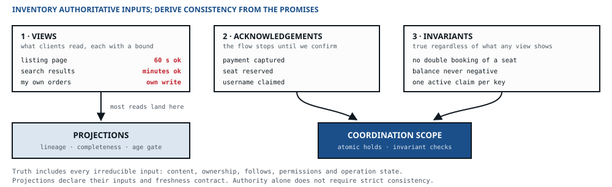

::: standfirst
**Now we go inside — and the first question is not which database.** It is which of your data is the truth, and which is just a copy of the truth, shaped for somebody's convenience. Get that line right and most of the rest of this chapter follows on its own.
:::

::: lead
A store holds state. That sounds like the simplest of the four types, and yet it is the one where I have watched the most expensive mistakes being made — because the word “database” walks into a design carrying a dozen decisions that nobody has actually taken yet.
:::

## What a store is answerable for

Every store in a design owes six answers, and a seventh wherever more than one process plays it. A store that cannot give them has not been designed yet — it has just been named, and that is not the same thing.

| Declaration | Why it is not optional |
|---|---|
| **Truth, or derived from truth** | Decides whether losing it is a catastrophe or an afternoon's rebuild. The rest of this chapter is mostly consequences of this line |
| **Durability and replication** | What failure it survives, and what window of writes it may lose in doing so |
| **Consistency offered** | What a reader is promised about how current the answer is. A menu, not a yes/no |
| **Query shapes served** | The access patterns it must satisfy. This, not the data model, is what selects the family |
| **Lifecycle and retention** | When data leaves, and by what mechanism. “Never” is an answer, and an expensive one |
| **Size, growth, and hot-key profile** | How big now, how fast growing, and whether the load is even across keys. The last one is what actually breaks things |
| **The channels inside it** | Only where more than one process plays it: the replication and membership channels between them, from which its durability and the consistency it offers follow. Chapter 07 takes them apart |

{cols="26%"}

## Define the concepts before choosing their representation

Carry the client's terms into the entity, state and view inventory. If *photo* refers both to uploaded bytes and to their catalogue record, qualify the two where they share a contract. Record whether a *thumbnail* is derived from an original, part of a presentation, or an instance of a named size. These relationships answer different questions.

ANSI/NISO Z39.19-2005 (R2010), §§8.3–8.4, distinguishes hierarchy from association, including kinds, parts and instances. TEOB uses that distinction to avoid a familiar modelling mistake: a payment related to a booking does not become a kind of booking. A vocabulary hierarchy supplies no evidence for software inheritance, ownership of a transaction or a separate deployment. Derive those choices from the invariants and operational constraints. Likewise, naming a table *truth* does not establish that all irreducible inputs survive.

## Truth and projection

If I had to throw away every other distinction in storage design and keep just one, it would be this one:

- A **source of truth** is authoritative. If it is wrong, the business is wrong. If it is lost, there is nothing else to rebuild it from.
- A **projection** is derived. It exists to serve one particular read well, and if it gets lost or corrupted you just rebuild it from the truth. It is allowed to be stale — within a bound that somebody has agreed to.

The reflex I see in most reviews is to pick a database and let the reads sort themselves out later. Start instead with the views, acknowledgements, invariants and **irreducible inputs**. A projection is rebuildable only when its complete inputs and required history are retained. Freshness tolerance alone does not make data derived: a slowly changing follow graph is still authoritative data.

Determine what is authoritative before choosing products. Then select durability, read consistency and transaction isolation independently for each class. The expensive, strictly coordinated operations can remain small without pretending that everything else is reconstructible.

::: figure

This chapter runs outside-in as well. The views arrive from chapter 02 and we do not reopen them here — what gets decided here is the *consequence* of a bound, never the bound itself.
:::

Two of those inputs — acknowledgements and invariants — need a word of explanation.

**An acknowledgement is a point where the client's flow stops until the system confirms.** Not every write is one. “Your profile photo has been updated” can be optimistic; “your payment has been captured” cannot. Every acknowledgement is a promise that something has been durably decided by the moment you return — and it is that promise, not the mere fact that data is being written somewhere, that demands an authoritative store.

And be precise about *what* is being confirmed, because there are three kinds, and they differ in cost by an order of magnitude:

| Kind | What the client is told | What it costs |
|---|---|---|
| **Receipt** | It is durably recorded and will not be lost; the work completes later, and you will hear about it | One durable append. Orders, uploads, submissions — most “we've got it” flows |
| **Reservation** | A contended thing is held for you, now, usually with an expiry | The strict store and the invariant that guards it, with the contention piling up on the hot keys. Seats, stock, unique names |
| **Completion** | The final state has been reached by the time this response arrives | The expensive one, and needed far less often than it is bought — a payment is usually a receipt, a completion behind it and a notification, and users accept that when the interface says so |

{cols="16% 40%"}

“Must be reliable” is not “must be synchronous”. Reliability is durability; synchrony is a decision about what the next screen says. Mix the two up and the whole write path gets dragged into the strict store, together with every scaling problem that store has.

Write them down carefully, kind included, because this answer travels further than it looks. An acknowledgement your own promise depends on makes the edge that carries it **commit-bearing** when chapter 07 gets to channels — and a commit-bearing edge cannot be given a fallback, because there is no lesser answer to fall into. Everything else can be accepted now and completed behind the client.

**An invariant is something that must be true regardless of what any view shows.** No seat booked twice. No balance below zero. One active claim per key. Invariants are the part of the model that no view can tell you about, and that is why we ask for them separately, and last. Each one gets exactly one *enforcer* — the single place where it is checked and can be relied upon — and a *scope*: per entity, per tenant, or global. Challenge the global ones: an invariant scoped to one entity is a row lock, and one scoped across all of them is a distributed transaction in disguise. Writing both down now saves you an argument about boundaries two chapters from here.

**The invariant determines the transaction protocol.** A conditional write is sufficient if all relevant state and checks fit its atomic scope. For multiple records, serializable transactions or a demonstrated locking/constraint protocol can enforce the rule. Snapshot isolation alone permits write skew: two doctors each see the other on call and both leave. Record the store’s configured isolation. Across partitions, consider a distributed transaction, different placement, or a protocol that preserves the rule. A saga is permissible only when its intermediate states are acceptable; compensation does not itself bound their amount or duration.

The enforcement ladder comes next, with a case that needs it, and after it the view a client is looking at when the collision happens.

::: primer
#### The enforcement ladder — how strictly an invariant is held

An invariant names its enforcer, and the enforcer still has a choice to make: how strictly to hold the line while many writers push on it at once. There are four answers, in falling order of strictness, and I call them [the enforcement ladder]{.term}. It is a different ladder from chapter 02's, and I keep the two names apart on purpose: the **degradation ladder** is what a *client* is handed when the system cannot deliver, the **enforcement ladder** is how strictly an *invariant* holds under concurrent writers.

| Rung | How | Violation | Price |
|---|---|---|---|
| **E1 · Serialised** | A transaction or protocol checks every change against the invariant | None within the stated failure model | Measured contention and coordination cost |
| **E2 · Escrowed** | The quantity is split into slices held by the writers; each spends its own slice locally and refills from the serialisation point | None — the bound holds exactly | Slack stranded in slices: a request can be refused while capacity sits in another writer's slice. Escrow turns overshoot into undershoot |
| **E3 · Bounded** | Admission and visibility limits enforce a stated error envelope; reconciliation closes it | A proved bound, including in-flight work and bursts | Overshoot, its loss, and reconciliation |
| **E4 · Detected** | No check on the path; an audit finds the violations and compensates | Unbounded until the audit runs | Every violation, priced. Legal only where each one is cheap and reversible |

Table: Escrow is O'Neil's (1986); Barbará and Garcia-Molina's demarcation protocol (1994) holds the same kind of safe limits per site. {cols="17% 37% 17%"}

**Pick the cheapest rung whose worst-case violation, priced per unit, the signatories accept.** *Priced per unit* is doing real work in that sentence — it is the loss line chapter 03 asked you to put beside every cost line. And there is one hard floor: an invariant whose violation would be rung 6 of the degradation ladder — a seat sold twice, a balance below zero — may sit on E1 or E2, and nowhere lower.

**E2 is a candidate for divisible rights.** Allocate disjoint slices durably, debit them atomically, and fence former holders before reclaiming or transferring rights. A timed-out holder can still be spending. Without these rules, escrow can overspend too. It reduces coordination for suitable additive constraints; it is not an escape hatch for every hot key.

For **E3**, rate × lag bounds unseen increments only when rate is a hard aggregate limit in quantity units and lag is a hard visibility limit, with bursts, concurrent checks, operation sizes and in-flight work accounted for. An average rate and a lag alarm do not prove a bound. State what stops admission when a limit fails, and what happens if reconciliation misses its deadline.

**At E3 the invariant carries two promises, so it has two enforcers.** The bound is enforced on the path. The exact figure is enforced by the reconciler — a processor in chapter 06's sense, with its own deadline, and the enforcer of record for anything that gets billed. At E4 the path checks nothing at all, and the audit is the only enforcer there is. None of that breaks the one-enforcer rule above; it sharpens it to *one enforcer per promise*. And the bound you accept at E3 is an accuracy tolerance like any other from chapter 02, signed the same way — there is nothing new to sign.
:::

::: example
#### A budget that one key cannot hold

Budget pacing in ad serving — and every figure here is **assumed**, because none of them is mine to measure. One dominant campaign spends at a peak of [20 000]{.num} events a second against one daily budget. A conditional write on one key serialises roughly [70–200]{.num} changes a second, from a [5–15 ms]{.num} commit. Divide, the way chapter 04 now insists: a load ratio (demand ÷ capacity) of about [100–300]{.num}. **An unbatched writer that waits for each commit cannot hold that key, whatever the node count** — the key lives on one node, and buying forty-nine more changes nothing about it. Batching or pipelining might; that is measured, not assumed. Suppose the measurement fails: then E2.

Fifty serving nodes each hold a slice of about one second of their own spend, and refill from the budget key when it runs dry — about [50]{.num} refills a second on the key, inside its ceiling — about a quarter of it at [5 ms]{.num} commits, about [70%]{.num} at [15 ms]{.num}; the slice size is the knob. The overshoot is zero, exactly. The undershoot is at most the slices outstanding: about one second of the campaign's spend, which for a budget spent evenly over the day is about 1/86 400 of it.

**And the two errors are not the same price.** Over-delivery is impressions nobody can bill; under-delivery is revenue left on the table. Escrow moved the whole error onto the side the business would rather have it on — which is the signed error bound of chapter 06, turning up a chapter early.
:::

::: primer
#### The view a client commits against

Most views can be stale and nobody is hurt: the page is a minute old, and that is all. One kind of view is different, and it deserves a mark of its own — **the view a client makes an irreversible or contended choice from.** A seat map before a purchase, a stock count before an order, a username field before a claim. Staleness there does not read as an old page. It turns into a broken promise: the interface showed the thing as available, and the commitment was then refused. The client was not shown old data — they were told something false at the moment they acted on it.

So mark every such view, and pick one of three answers on purpose:

- **Read authority to remove replica lag.** This improves the observation but does not reserve the resource until a later write.
- **Reserve atomically at the point of promise.** Two clients can both read “available” from a linearizable store. Only an atomic conditional hold tells one of them the resource is now theirs. Return the hold identifier and expiry, and require that hold at checkout.
- **Keep the projection and design the refusal.** A clear, fast, apologetic *no* that the interface has prepared the client for. Legitimate when collisions really are rare and one of them costs little.

What is not on the list is the fourth thing, which is what most designs do without ever deciding to: keep the projection, promise nothing about it, and let the refusal arrive as a surprise at the moment of payment. Chapter 09 puts a counter on exactly that event, and its target is zero.
:::

## The two mechanisms behind every store

Before we pick a family, it is worth understanding the two things almost every distributed store does for a living, because both of them get bought all the time without anyone noticing they were on the bill.

::: primer
#### Replication — more than one copy of the same data

**What it buys.** Three distinct things, and you should be clear about which one you are actually paying for. **Durability**: a copy survives the loss of a machine. **Read throughput**: readers can be spread across the copies. **Availability**: if one copy is unreachable, another one answers.

**What it costs.** A write now has to reach more than one place, and you have to decide whether to wait for it. That one decision is the whole trade:

- **Synchronous** — the write is not acknowledged until a replica has it. No data-loss window, but your write latency now includes the slowest replica in the set, and if that replica is down, the write fails. You have traded availability for durability, and you have done it deliberately.
- **Asynchronous** — acknowledge before copying to the backup. This can shorten the write path, but it does not make the primary always available. Declare what happens to acknowledged, unreplicated writes if it fails: recover the primary, accept a stated loss, or refuse unsafe failover. Reader consistency depends on which replicas serve and how authority is fenced.

**And a second question appears that did not exist with one copy:** what does a read see? Once the copies can lag, reading from any one of them means possibly reading old data. That is where the consistency menu below comes from — it is not an abstract taxonomy, it is just the list of answers to that question.

**And the copies talk to each other.** Whatever carries a write from one copy to the next crosses a process boundary — usually a machine, often a zone — so it is a transfer in exactly chapter 07's sense: a channel, with a guarantee, an order, a lag and a way of failing, every one of them set by a configuration line you may never have opened. The durability you declare for the store and the consistency you offer its readers are that channel seen from outside, and chapter 07 takes it apart. One thing belongs here already: copies that share a machine, a rack or a zone fail together, and a replica that dies with its primary has bought you nothing at all.
:::

::: primer
#### Partitioning — splitting the data across machines

**What it buys.** Two things, and only two: write throughput beyond what one machine can absorb, and a dataset bigger than one machine can hold. If neither of those is your problem, partitioning is not your answer.

**What it costs.** Rather more than people expect, and all of it lands on the query side:

- **The key decides everything.** Queries that include the partition key go to one machine and come back fast. Queries that do not have to be sent to every partition and the results merged — a scatter-gather, whose latency is that of the slowest partition, and whose cost grows with the partition count.
- **Transactions across partitions stop being free.** Inside one partition a transaction is just a transaction. Across two it becomes a protocol — two-phase commit, or a saga with compensations that you have to design and test yourself.
- **Hot keys.** Load is only spread if the key spreads it. One celebrity account, one popular product, one tenant ten times larger than the rest, and a single partition carries a disproportionate share of the load while the others sit idle.
- **The key is the scope key of the invariant that is hardest to move.** An invariant held inside one partition is a transaction; one that crosses partitions is a protocol, so the key goes where the most expensive invariant needs it. Where two invariants disagree about the key, one of them pays — and that is the finding, not a detail. The [booking derivation](../derivations/04-the-invariant.html) has exactly this pair: *no room double-booked* is contended per room-night, *at most one room per guest on any date* per guest-night, and a key that serialises one does not serialise the other.
- **Resharding is a project.** Changing the number of partitions, or the key, later on means moving data while you keep serving traffic. Consistent hashing and similar schemes reduce how much has to move; they do not make it an afternoon's work.

And one specific trap: **partitioning a relational store surrenders most of the features you chose it for.** Joins across partitions, foreign keys and multi-row transactions are what relational stores are good at, and they are the first things to go. So if you are about to shard a relational database, check first whether the write volume genuinely demands it — chapter 04's division is the check — because if it does not, you are about to pay the full price and get nothing back for it.
:::

::: primer
#### Quorums — how a replicated store still gives a straight answer

With [N]{.num} replicas, writes to [W]{.num} and reads from [R]{.num}, **R + W > N** gives an intersection when both use the same replica set. That is a useful ingredient, not a complete consistency protocol. Explain version ordering, concurrent and partially failed writes, membership changes and how readers resolve divergent versions before claiming a particular guarantee.

With [N = 3]{.num}, choosing [W = 2]{.num} and [R = 2]{.num} gives [4 > 3]{.num}, and tolerates one node being down for both reads and writes. Choosing [W = 3, R = 1]{.num} makes reads cheap and fast, but now a single unavailable node blocks every write. **The knobs are how you spend a fixed budget between read latency, write latency and failure tolerance** — and the default your store ships with has already spent that budget for you, quite possibly in a direction that is not yours.
:::

## The consistency menu

Replication turns “what does a read see?” into a real question, and there is a whole spectrum of answers to it. Each one costs something, and each one maps to a complaint you will not be getting.

| Guarantee | Means | Costs | Buys you |
|---|---|---|---|
| **Linearizable** | Every read sees the latest committed write | One authoritative ordering point per operation — a fenced leader, or consensus; the latency floor rises with distance | Balances, uniqueness, locks |
| **Sequential** | Every reader sees the writes in one agreed order, though not necessarily the latest | One ordering point — a leader or a totally ordered log — without a real-time read path | Coordination and configuration data read from followers |
| **Causal** | Effects are never visible before their causes | Session tokens or version tracking on the read path | Comments, collaboration, anything conversation-shaped |
| **Read-your-writes** | A client always sees its own effects | Read the authoritative write history, or carry a session version and wait/route to a replica that has applied it; preserve that requirement across failover | “I edited it and nothing changed” |
| **Monotonic reads** | No going backwards in time | Sticky routing to one replica — which the next rolling deploy takes away | Feeds and timelines that flicker |
| **Eventual + a bound** | Converges within a stated window | A completeness watermark and age gate, plus fallback or refusal when freshness cannot be established | Search, aggregates, caches |

Table: Not a straight ladder, but a ladder with a fork — and a second axis beside it. On order, linearizable implies sequential, which implies causal, and causal implies each of the session guarantees, which hang beneath it side by side: read-your-writes and monotonic reads are two of them, with no arrow between them. Eventual with a bound is on the other axis: it limits age rather than order, so only linearizable is above it. A causal store can quite properly serve you a read from last week. {cols="19% 27% 27%"}

::: figure

Stronger on the left, weaker on the right, and nothing in the right-hand column is above anything else in it. The menu above carries two of the four session guarantees; the other two are the specification's.
:::

The selection rule has not changed: **pick the weakest guarantee that satisfies the tolerance recorded in chapter 02.** What the fork changes is what to do when a class needs two guarantees that sit side by side. The seller who must see their own edit *and* must never watch the page go backwards wants read-your-writes and monotonic reads together, and since neither implies the other, buying one does not get you the second. There are two honest ways to pay: the two mechanisms, one each, or the one guarantee above both of them, which is causal. Take whichever is cheaper, and write down which one you took. What I would not do is buy causal by default, as a convenient way of getting two session guarantees in one purchase — sometimes it is the cheaper way, and sometimes it is version tracking on every read path, bought to save a pin. (The four session guarantees — read-your-writes, monotonic reads, monotonic writes and writes-follow-reads — were named as a set by Terry and his colleagues, in 1994.)

Read-your-writes has an order of attack, cheapest first. Return the resulting entity in the write response, which is usually enough. Failing that, pin that caller's session to the authoritative read. And only as a last resort make the projection synchronous — that turns a cheap view into an expensive one, and it should be argued for, not slipped in.

Two of those rows have a catch that the cost column is too small to hold, and it is worth a paragraph of its own. **Read-your-writes and monotonic reads are usually bought with a pin** — to the leader, or to one particular replica — and a pin is a piece of state attached to a machine that can go away. Replicas scale in. Rolling deploys replace them one at a time. Spot instances get reclaimed. When the machine at the far end of the pin leaves, the guarantee leaves with it, quietly: nothing fails, no error is raised, and the class silently drops to eventual for as long as it takes the routing to settle. That is a channel question rather than a store question — chapter 07 asks it as the *far side* property — but the promise being voided is this chapter's, which is why it is worth knowing here that the promise has a shorter life than the session that carries it.

A freshness bound needs enforcement as well as observation. Measure a completeness watermark, include queue and processing delay, and test it before serving. If it is too old or cannot be established, use the agreed authoritative fallback, refusal or separately signed degraded contract. A 30-second alarm does not prevent serving a 61-second-old answer. The newest visible item’s timestamp is not necessarily a completeness watermark.

## Matching the family to the access pattern

Only now — with the truth separated from the projections, and each one's access pattern and consistency need written down — does naming a technology become a derivation rather than a preference.

| Family | Fits | Breaks, or costs |
|---|---|---|
| **Relational** | Transactions, joins, constraints, flexible query shapes. **The default until something forces otherwise** | Single-primary write ceiling; sharding surrenders the features you chose it for |
| **Distributed SQL** | Serializable semantics with horizontal scale and geo-replication | Consensus per commit adds a round trip; operationally heavy; unjustified at modest write rates |
| **Key-value, in-memory** | Hot working set, sessions, counters, rate limits; sub-millisecond point reads | Bounded by RAM; durability is a configuration rather than a given. **Never the source of truth** |
| **Key-value, durable** | Predictable single-digit-millisecond reads at any size, keyed access only | The query shape *is* the key; item-size limits; cost scales with provisioned throughput |
| **Wide-column / LSM** | Very high write throughput, linear scale, per-query table design, native TTL | Ad-hoc queries; compaction and tombstones; secondary indexes disappoint |
| **Document** | Aggregate-shaped records read and written whole; evolving schemas | Cross-document transactions and joins; unbounded nested growth; schema debt deferred, not avoided |
| **Search index** | Text relevance, faceting, filtering across many attributes | **Always a projection, never truth.** Near-real-time rather than instant; the reindex path must be designed, not discovered |
| **Columnar / analytical** | Large scans and aggregations, heavy compression, reporting | Point updates and high-rate point lookups; small frequent inserts |
| **Object store** | Large immutable blobs, cheap and durable; archival tiers | First-byte latency in the tens of milliseconds; **listing is not querying** — a catalogue is required |
| **Log** | Ordered, replayable truth with fan-out to many readers; compaction gives table semantics | No random access; every consumer keeps its own position and its own deduplication. Retention × throughput is disk arithmetic you have to do |

Table: Abbreviated; the specification carries the full list. Each row is selected by an access pattern, never by familiarity. {cols="20%"}

::: primer
#### A cache is not a fifth kind of thing

It is **a derived store with an invalidation contract**, and I insist on that phrasing not out of pedantry — it forces the two questions that the word “cache” lets you skip.

**Derived from what, exactly?** If you cannot name the store it is derived from, it is not a cache. It is a second source of truth that nobody is maintaining, and the two will quietly drift apart.

**And what is the invalidation contract?** How does an entry stop being served once the underlying truth has changed — a TTL, an explicit purge when the truth changes, a version key? Whichever it is, it implies a staleness bound, and that bound must be no looser than the one the client agreed to in chapter 02. A cache with a five-minute TTL sitting in front of a view whose promised freshness is thirty seconds is not an optimisation. It is a broken promise with good latency.
:::

::: example
#### The same data, three access patterns

A marketplace listing. One entity, read by three populations who want completely different things from it.

- **The seller** edits a listing and immediately reloads the page. They must see their own change — *read-your-writes*, no exceptions, because the alternative is a seller editing the same field four times over.
- **A buyer** searches for “blue running shoes size 10”, filtered by price and rating. That is text relevance and faceting across many attributes, and the freshness bound this class gave us is *minutes*.
- **Finance** runs a monthly report that joins every listing against every transaction. Large scans, heavy aggregation, and nobody cares whether it reflects the last hour.

At sufficient load these access patterns can interfere. Measure that interference before splitting; possible failures include the following. Serve all three from the relational truth store, and the search queries and the monthly full scan land on **the one store you can least afford to slow down** — the one that has to stay fast for the seller's transactional write. Or pick a store that is genuinely good at search and faceting, and then discover it cannot give the seller read-your-writes on a transactional edit.

**The division follows both lineage and the promises.** Seller edits are irreducible input, so listing records are authoritative. Search and finance views can be projections because their complete inputs are retained, and each can tolerate its separately agreed lag. Workload measurements decide whether they need separate stores; tolerance alone does not.

**And now count what that cost.** One seller edit now touches three stores — a write amplification of [3×]{.num}. That number did not exist before this chapter; it exists *because* we chose two projections, and it has to be carried into the capacity pass rather than discovered when the write path gets slow. Every projection is a real, recurring cost: a rebuild path, a staleness bound somebody has to monitor, and a share of every write.

Which gives us the honest stop rule. If the buyer's search were a simple filter on two indexed columns, and the finance report ran quarterly against a hundred thousand rows, the right answer would be **one store** and no projections at all — and reaching for three would be the very same reference-architecture reflex that chapter 04 deleted.
:::

::: warn
**Choosing the truth store first, then discovering the reads.** This is the default order, and it produces the same shape every single time: one large authoritative store, serving every query in the system, compromised across all of them and fast for none. The reads were always going to arrive. Asking for them first costs nothing; retrofitting projections around a store that everything already depends on costs plenty.
:::

::: thread
#### What is truth here, and what is merely expensive to lose

Take the inputs in order: views, acknowledgement, invariant, then the irreducible inputs. The views are: an album page, a single photo, and the uploader's own recent uploads. The acknowledgement is *your photo is safely stored* — a receipt: the bytes are durable, and the sizes follow. The invariant is that a photo is only ever visible to the people its owner has allowed to see it.

- **Truth:** the original bytes, in the object store — and **a catalogue row** in a relational store, holding who owns what, when it arrived and who may see it. The catalogue is there because *listing is not querying*: the object store cannot answer *which photos did this user upload in March*, and the invariant needs an enforcer that can.
- **Derived:** four thumbnail sizes. They are rebuildable from the original, so they may be lost, and they are bounded by the viewer's [60 s]{.num} from chapter 02.

The uploader gets read-your-writes on their catalogue row. Viewer metadata has an agreed 60-second freshness bound, carried by a watermark and serving-time gate with a defined refusal when it cannot be established. Permission revocation has its own stricter contract; the freshness allowance does not override it.

**The catalogue mutation and permission enforcement are separate obligations.** A conditional update can protect the permission record, but it does not stop a CDN or client from serving an older copy. The serving path needs its own revocation contract; chapter 07 records that unresolved gap.

**And the two decisions chapter 01 handed us together with the object store.** Retention has no clock: an original lives until its owner deletes it or closes the account, which is why chapter 04's pile only ever grows. Replication is the object store's own, across the zones of our one region, and the catalogue gets a synchronous replica — bought by the acknowledgement, because *safely stored* cannot be said of a row that has one copy. Both are **assumed** until somebody with the authority signs them.

**One upload now lands in three stores** — the originals, the catalogue and the derived sizes — which is a write amplification of [3×]{.num} counted the way the marketplace was, and **six writes** in all, because the derived store takes four of them: one original, four thumbnails, one catalogue row. Neither number existed before this chapter. They exist because we chose four derived sizes, and we carry them into chapter 07 rather than discover them later.
:::

::: rule
Account for every irreducible input and every projection’s retained dependencies. Then choose the weakest consistency and coordination that fulfil each promise.

A projection is rebuildable because its inputs survive, not because the client can tolerate a stale answer. Keep strict coordination as narrow as the invariants allow, and give authoritative data its own durability and lifecycle contracts.
:::

::: owes
- Specification §02 · [Names carry a scope and a contract](../method.html#naming) — scoped terms, preserved behavioural distinctions and the ANSI/NISO Z39.19-2005 (R2010) adaptation
- Specification [step 03 · Data](../method.html#s03) — views, acknowledgements in their three kinds, and invariants; truth against projection; the view a client commits against; the consistency menu as a ladder with a fork, and the read-your-writes fix order; one enforcer and a scope per invariant, the isolation the scope requires, and the enforcement ladder
- Not carried here, and governed by the specification alone: the conflict policy a class with more than one writer owes, minimisation, and the two kinds of lifecycle
- Specification [step 04 · Storage & transport](../method.html#s04), stores half — the family table and the access-pattern match, and the partition key as the scope key of the hardest invariant
- Specification [§02 · Primitives](../method.html#prim) — the store's six declarations and the seventh where several processes play it, and the cache as a derived store with an invalidation contract
- The session guarantees are Terry, Demers, Petersen, Spreitzer, Theimer and Welch's (PDIS 1994); write skew under snapshot isolation is Berenson, Bernstein, Gray, Melton and the O'Neils' (SIGMOD 1995); escrow is O'Neil's (*ACM TODS*, 1986), and the demarcation protocol Barbará and Garcia-Molina's (*The VLDB Journal*, 1994)
:::
