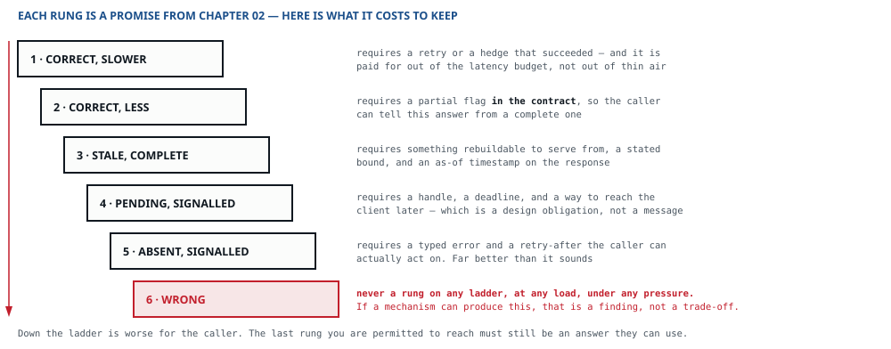

::: standfirst
**Everything in Part II assumed the parts were working.** Here I stop assuming. Nobody makes a promise in this chapter — the promises were made back in chapter 02, by the only people who were entitled to make them. What happens here is the humbler job: you sit down with each of them and work out what it costs to keep.
:::

::: lead
The easy way to write this chapter would have been a list of resilience tactics — timeouts, retries, circuit breakers, bulkheads. They all turn up below. But a list of tactics is not a failure model, and the difference is quite simple: a failure model [starts from a promise]{.term} and works back to the mechanism. A list starts from the mechanism and hopes it happens to cover something.
:::

## The ladder was written before any of this existed

Back in chapter 02 we asked every client class which degraded outcomes it would accept, and got six answers back, in rising order of severity. I want to be clear about what that list is, because I have seen it read as a wish list of things to implement one day. **It is a set of commitments**, and this chapter has one job and one only — to show that every one of them can actually be reached, and to put a price on reaching it.

::: figure

The rungs are chapter 02's, in the client's own words. The right-hand column is what this chapter adds — and rather a lot of it is real design work, not a setting you switch on.
:::

Read the right-hand column slowly; that is where the work hides. **Rung 3 is not free** — you need something rebuildable to serve from, and whether you have one is a decision chapter 05 either made or did not make. **Rung 4 is not a message**, it is a way to get back to a client who has already gone away. And if chapter 02 accepted a rung the design has no way of reaching, I would much rather you found that out now, while it is cheap, than in the middle of the first incident.

**And price every rung twice.** What reaching a rung costs to build is the half this chapter has always been about. The other half is what each landing on it costs the business — the loss lines chapter 03 put beside the cost lines: an hour of a paying class on rung 5, an SLA credit, a refund. The two halves answer different questions. A rung that is cheap to build and expensive to land on wants rehearsing far more than its build cost suggests. And a mechanism whose running cost dwarfs the expected loss it prevents is correct and unjustified — the same verdict chapter 07 gives a ratio in the hundreds.

**One line connects this ladder to the other one.** Rung 6 is never permitted, and an invariant whose violation *would be* rung 6 — a seat sold twice, a balance below zero — is held on E1 or E2 of chapter 05's enforcement ladder and on nothing lower. The two ladders measure different things, and this is the one place they touch.

## Two dimensions, and most designs answer only one

There are two independent questions hiding inside the word reliability, and they come from two different places on the same client table.

- **How often may it fail?** That is the availability figure, and it turns into the published objective — the SLO of the next chapter.
- **How badly may it fail?** That is the ladder. Frequency has nothing to do with it; what the client is left holding has everything to do with it.

**A design that answers only the first has an SLO and no plan.** Three nines tells you how much of the year you are allowed to spend failing. It tells you nothing at all about what a user sees during those minutes — and those are exactly the minutes the support tickets come from.

::: primer
#### A timeout is a slice of somebody else's budget

Most timeouts I come across were set the same way: somebody picked a round number that felt safe — thirty seconds, say. That number is always wrong, and it is wrong in one very specific way: **it is longer than anyone is waiting.**

The client gave you a budget — chapter 02 wrote it down, say [p99 200 ms]{.num} at the edge. That budget has to be shared out across every hop that serves the request. If a read goes through a surface, a cache and a store, then three timeouts, plus the retries, plus the network, all have to fit inside 200 ms. Put a 30-second timeout on the innermost hop and here is what happens when the store is unwell: the caller sits there for 30 seconds, waiting to be told something the budget says it should have known in a fifth of a second.

**Deadline propagation is the same idea done properly.** The request carries how much time it has left, every hop subtracts what it used, and a hop that finds nothing left simply *stops* — if nobody is waiting for the work, the work should not be running. Without it an overloaded system spends whatever capacity it has left diligently computing answers nobody will ever read, and that is exactly how slow turns into down.
:::

::: primer
#### The tail multiplies with the fan-out

Sharing a budget across hops in a row is the half everybody does. The other half is the hops side by side, and the arithmetic there genuinely surprises people. If the calls are independent and each of *N* parallel calls is slower than its p-th percentile with probability 1 − p, a request that waits for all of them is slower than that with probability **1 − pN**. At p99, ten leaves put about [10%]{.num} of requests past the leaves' p99; a hundred leaves put about [63%]{.num} past it. That second figure is Jeff Dean and Luiz Barroso's, from *The Tail at Scale* (2013), and it is the one I would have everybody say out loud once. Turned round it is worse still: to hold the request at p99 across a hundred leaves, each leaf needs about **p99.99**, because the hundredth root of 0.99 is about 0.9999.

Three answers, and the point is to pick one on purpose rather than discover which one you have:

- **Fewer leaves.** The cheapest, when the data can be laid out so that a request touches fewer of them.
- **Hedged requests.** Send a second copy only once the first has been outstanding past about the p95 — Dean and Barroso put the extra load at about [5%]{.num}, not double. Sending the duplicate straight away is what doubles it, and it is the version people reach for first. Both figures assume the leaves are slow independently, and under shared congestion they are not, so measure the joint tail; and a hedge needs a receiver that is safe to run twice, a load budget of its own and a way to cancel the loser — a nominal p95 trigger does not cap the extra load during an incident. Either way it is load the hedged tier now carries, and chapter 07's fourth field is where that gets written down.
- **Partial results** — which is rung 2 of the ladder, so it has to have been promised, and it has to carry its marker.
:::

::: primer
#### Retries, and the storm they cause

A retry turns a transient failure into a success, which is why everybody adds them. It also multiplies the load at exactly the moment the far side is least able to take it, which is why retries are the most common way I have seen a small problem grow into an outage.

Three properties make a retry safe, and you need all three of them:

- **A bound.** Not “retry until it works”. A retry budget — a fixed count, or a proportion of all requests, so that retries can never make up more than a stated fraction of the load you generate.
- **Backoff.** Gaps that grow exponentially, so a struggling dependency hears less from you, not more.
- **Jitter.** Randomised delays. Without it, every client that failed in the same instant retries in the same instant, forever, as one synchronised herd — and the dependency recovers for just long enough to be knocked over again.

And one property on the receiving side, which chapter 06 already settled: **idempotence**. A retry without it is just duplication with extra steps.

**Idempotency makes a retry safe; it does not tell you what happened.** A receiver may commit, lose its reply, then remain unreachable beyond every retry deadline. Model operation state separately from the caller’s knowledge. The caller can honestly receive *outcome unknown*, with an operation identifier and a status/reconciliation path. *Accepted, pending* needs a known durable acceptance point; *refused* needs evidence that nothing was accepted. Keep retries bounded and give durable operations a lifetime separate from the RPC deadline.

**Then design for hostile retries anyway.** You do not control how your callers behave, and some of them will retry immediately, with no backoff, forever. So the mechanisms that protect you have to live at your own edge — per-class token buckets, a jittered `Retry-After`, shedding at the surface — and not in a client library you are hoping everyone will use.
:::

::: primer
#### Failing fast, and failing in one place only

Two mechanisms, both from Michael Nygard's *Release It!*, and they answer two different questions.

**A circuit breaker** answers *should I even try?* After a run of failures it stops calling the dependency and fails straight away, into a defined rung — stale data, a default, a typed error. People tend to think it is there to protect the dependency. It is not — it is there to stop you queueing up work that is doomed anyway, because a queue of doomed requests eats the threads, the memory and the patience you needed for the requests that would have succeeded. And the rung it falls into has to be one the class accepted.

**Which is also why a breaker is not legal on every edge.** Chapter 05 asked which acknowledgements stop the client's flow until the system confirms, and chapter 07 carried that answer onto the edge as *commit-bearing*. On one of those, there is nothing to fall into: a fallback is either a write that was lost or a write that happens twice, and both of them are rung 6 wearing a resilience pattern's clothes. What you have instead is the two honest rungs — accept the work and return a handle, or refuse in a typed, retryable way and let the caller decide. A breaker with a fallback belongs on the latency-optimised edges, which is most of them, and that is exactly why the exception gets missed.

**A bulkhead** answers *who else does this take down?* Separate pools — of connections, of threads, or of whole instances — so that one dependency going slow exhausts one pool and not every request in the process. The name comes from ships: one compartment floods, the vessel stays afloat.

The shed order from chapter 02 is what turns a bulkhead from a configuration setting into a design decision: it already says which class loses first, so it already says which pool is allowed to starve.

And notice that the pool in that paragraph is not a new thing introduced here. It is the **backpressure** property of a synchronous channel, declared back at chapter 07 — the queue that a blocking call waits in. A bulkhead and a backpressure policy are one decision looked at from two chapters: what should happen when the far side cannot keep up, and who is allowed to be hurt by the answer.
:::

::: primer
#### What happens when a replica leaves

Timeouts, retries and breakers all assume the far side is a thing that is either up or down. It is neither: it is a set, and the set changes all day. Deploys replace it a machine at a time, autoscaling takes members away at the quietest moment, and a scheduler will move one because a node needed draining. Chapter 07 made that a property of the edge — the *far side*, and what the channel does on *departure*. This chapter owes the half that hurts.

**The planned departure is a solved problem that is almost always solved wrongly.** Not because draining is hard, but because the drain timer gets picked the same way the thirty-second timeout did: a round number that felt safe. It is derivable. Stop advertising, wait out however long the routing layer takes to notice — that is the staleness bound chapter 07 made you write down — and only then finish what is in flight, inside the latency budget the edge already inherits. Drain for less than that first interval and you have not drained at all; you have gone quiet while work was still arriving, which is a crash that files a ticket.

**The unplanned one is where the ladder earns its keep.** A machine that is killed rather than asked has left work in three different states, and each one is paid for by a decision already made:

- **An asynchronous consumer** replays from its last commit point through the atomic effect/deduplication protocol from chapter 07. The retention window must cover redelivery and any supported backfill. Recovery costs storage, processing and time; a stable key alone does not make it safe.
- **An asynchronous producer** loses whatever it had buffered and not yet seen acknowledged. This is not a surprise either — it is the delivery guarantee being honest about itself. If that loss is unacceptable, the guarantee was the wrong one, and the fix is upstream at chapter 07 rather than here.
- **A synchronous caller** can be left with an unknown outcome. Stable operation identity prevents duplicate effects; status lookup and reconciliation establish the result once communication permits it. Until then, keep the uncertainty explicit.

And one that catches people out because it fails so quietly: **any guarantee bought with a pin dies with the machine it was pinned to.** Chapter 05's read-your-writes and monotonic reads are the two, and neither raises an error on the way out. They just stop being true for a while. If the class that was promised them is one whose next rung down is one it does not tolerate, that transition is a page — and it is a page nothing will fire unless somebody decided it should.

**And the replica that gets promoted.** When a primary dies and a replica takes over, the writes the old primary acknowledged and never passed on are gone — exactly as many as the replication channel's guarantee allowed, which is why the recovery point is read off that channel and not off a wish. Two primaries at once is a split brain. So somebody has to decide when a member is really gone — decide too fast and you get two primaries, too slowly and you get an outage — and the ladder has to say what each class is handed while the store makes up its mind.
:::

## Every degraded answer carries a marker

This is the rule that separates a ladder from a set of good intentions. It is also the one I see skipped most often — and it gets skipped precisely because skipping it is invisible.

**Silent degradation is the dangerous kind.** A partial answer that does not say it is partial has not delivered rung 2 — it has delivered rung 6 dressed up in rung 2's clothes. The client was told something false, believed it, and acted on it. And the distance between “correct but less” and “wrong” is not in the content of the response at all. **It is one flag.**

So every degraded response carries something the caller can branch on: a partial flag, an as-of timestamp, a degraded header, a typed error code. Three things follow from this, and the third one is the one nobody sees coming:

- **The client can make its own decision.** A dashboard will quite happily render stale data with a timestamp on it — a reconciliation job has to refuse exactly the same data. Only the caller knows which of the two it is, and it cannot choose if you never told it.
- **The marker is part of the contract**, so it is part of the schema, so it is a chapter 07 decision — and it has to exist before the failure does.
- **The markers are your instrumentation, free.** The rate of partial flags per class *is* the rung distribution. Chapter 09 is going to ask for exactly that number, and this rule has already produced it without anyone noticing.

Keep these markers tied to the outcome definitions from chapter 02. An ambiguous *failed* value must not tell the caller it is safe to issue a new operation when the first operation may have committed. Distinguish a known refusal from an unknown outcome and give the latter its status/reconciliation path. No result label can turn missing evidence into a known failure.

::: example
#### The export that was “correct but less”

A nightly export to a partner: every transaction of the previous day, in one file. It has been running quietly for two years.

Then one night a storage shard goes away for forty minutes. The export job does exactly what it was built to do: reads what it can, writes the file. The file holds [94%]{.num} of the day's transactions, and nothing in it says so. No error, exit code zero, dashboard green — because, strictly speaking, the job did not fail.

The partner reconciles against it, finds transactions in their own system that have no match in yours, and — quite reasonably, since your file has always been complete before — treats them as errors and writes them off. **The damage lands eleven days later**, in a finance meeting of all places, and takes three weeks to unpick.

**Now look at where the design failed, because it is not where it feels.** It was not the shard — shards go away, that is just a fact about hardware. And it was not the job's decision to return partial data either: for plenty of consumers that is genuinely the right call, and rung 2 exists precisely because “some of it” so often beats “none of it”.

**The failure is that the file could not tell the truth about itself.** The format had no field for completeness, so the job had no way of delivering rung 2 even though it had actually reached it. Its only honest options were the whole file or an error, and that night it had neither.

One row count and one `complete: false` in the manifest would have turned eleven days of silent corruption into a partner alert at 04:00 — not a pleasant hour, but a much better one than the finance meeting. That field is a schema decision, made in chapter 07, on the strength of a tolerance written down in chapter 02 — **and it costs nothing if you write it down before you need it, and cannot be added afterwards to a file that has already been believed.**
:::

::: warn
**Discovering the ladder during the incident.** A rung nobody has ever exercised is fiction. The fallback path that has not been run since the day it was written will have a stale config in it, or an expired credential, or a dependency somebody has since deleted — and you will find all of that out at the worst available moment. Every rung is reachable on purpose, by a flag, a breaker or a shed rule, and rehearsing it deliberately is the only way to know that it still is.
:::

## Blast radius, and where it comes from

One more question completes the model, and you can answer it from artifacts you already have: **when this fails, what else fails with it?**

Chapter 07 counted the edges crossing each runtime boundary. Every one of them is a place where partial failure has just become possible — one side up, the other side down, and a caller stuck in the middle deciding what to hand its own client. That count is the first half of blast radius.

The traceability count identifies shared dependencies worth inspecting. It does not establish which promises fail together: the failure mode, redundancy and fallback determine that. Prioritise rehearsal by consequence, exposure and uncertainty; a single severe promise can outweigh several minor ones.

## Stressing it on purpose

Both halves of blast radius are *static* — counts taken off artifacts sitting at rest. This section adds the dynamic half, and as it happens you have already watched its first move. Chapter 04's photo thread asked what happens if the CDN's hit rate is not the one we assumed, and put the answer on the risk register; the block that closes this chapter runs the same question to the end — the CDN degrades, the 20× read reduction vanishes, the origin sees a twentyfold surge, moderation gets shed, uploads keep their pool. One imagined fact about the outside, traced through the components it touches, ending in a mechanism that cites a promise. Do that systematically and you have the [stress pass]{.term} — adopted into the method at V4.6 from Barry O'Reilly's residuality theory, and taken apart on the way in. It lands in three places: its cheapest slice was chapter 02's, taken while the people who can sign were still in the room; the full pass, with its instrument, is here; and chapter 11 fires it once more at the finished map.

::: primer
#### Stressors, attractors, and one matrix

A **stressor** is any fact about the context you do not currently know — a regulation, a viral spike, a partner failing, a clock drifting. An **attractor** is the state the system falls into when one of them hits; a ladder rung is an attractor you *designed*, an outage report is one you did not. Three rules for generating them, and they are his, not mine: **no probability** — likelihood filters nothing at this stage. **Everything goes in the list, however ridiculous.** And **no generic stressor lists** — generic stressors give you generic patterns, and the industry has tried that already. Generate them by abusing your own nouns instead: every client class, data class, schema and component name on the board.

Then the **incidence matrix**: stressors down the side, components across the top, a 1 wherever the stressor forces a change or a failure. You read it mechanically, and the readings are the instrument.
:::

::: figure

Toy scale, on purpose. The ticket-booking exercise used LLM reviews and found useful gaps, with contamination limits and a negative registered result. See the [evidence summary](../evidence/stress-demonstration.html); it does not establish superiority over ordinary review or saved production time.
:::

Three guards keep the pass honest — mine this time, not his — and all three are rules the method already had, wearing new clothes:

- **A stressor is a probe, never a requirement.** It goes into the matrix and nowhere else: it never becomes a row of the traceability map, and it carries no number into the arithmetic. A run has exactly three legal outputs: a newly *stated requirement*, signed like any elicited one — a client you discovered is still a client; a *finding* — a shared fate, an unreachable rung, a missing capability class; or a *recorded option* — designed, primed, not built, with its trigger written down. You never build for Godzilla. You record the cheap decoupling point and the trigger that would build it, and the option costs you a paragraph.
- **The matrix total is a measurement, not a target** — the same guard as the coupling count, seen from the other side. A split that is justified by a stressor row alone, with no promise traced to it, is furniture with a scary story attached.
- **Convergence is looping** — new stressors landing on residues you already hold. Check it empirically: hold back a handful that were never used in the design, count the survivors before and after, and report the index *with its denominator*. At the scale of a chapter it is a direction signal and nothing more.

The ticket-booking LLM reviews found that the design modelled purchases without a reversal workflow. That is a useful review finding. The evidence does not establish that interviews could not find it, that only stress would find it, or that a year was saved. The [evidence summary](../evidence/stress-demonstration.html) records the prompt contamination and the isolated run’s failure to reproduce the registered seat-map diagnosis.

::: thread
#### What the photo system owes when the pieces are gone

Two rungs were accepted back in chapter 02, and both of them get their price now.

- **The uploader accepted rung 4** — *accepted, not yet processed*. That needs a handle and a deadline, and as it turns out we have already paid for both: the catalogue row from chapter 05 *is* the handle, the thumbnail state on it is how the client gets told later, and the deadline is chapter 07's 24-hour TTL — the longest a photo may sit *pending* before its resize is re-derived instead of waited for. Rung 4 costs nothing extra here, because chapter 05 happened to build exactly the thing it needs.
- **The viewer accepted rung 3** — an older version of an album. That needs something rebuildable to serve from, with a stated bound — the four thumbnail sizes from chapter 05 and the [60 s]{.num} from chapter 02 — plus an as-of timestamp on the response, and that timestamp is a schema field somebody has to add now, not later.

**The interesting failure is the CDN, because it is outside the boundary.** Chapter 01 put it there and chapter 03 explained why — all we hold of it is a contract. So we cannot fix it; all we can do is characterise it and design around it. (The fan-out tail, by the way, does not bite here. An album page does load its thumbnails side by side, but the browser draws each one as it lands and nothing of ours waits for the whole set — and chapter 02's promise is per read, at the edge. If the page ever starts waiting for all of them, that primer is the arithmetic to do first.) If the CDN is degraded, the [20×]{.num} read reduction from chapter 04 disappears and the origin suddenly sees [100/s]{.num} instead of [5/s]{.num}. A twentyfold load increase, courtesy of a dependency failure — and that is exactly what a bulkhead and a shed rule are for: moderation is shed first, viewers get served, uploads keep their own pool.

And the marker rule bites in a place I would not have guessed. If a thumbnail is missing and the page quietly falls back to the full-size original, the viewer gets a perfectly correct image — and we have just served them [3 MB]{.num} instead of a thumbnail of [40 KB]{.num} or so, which is seventy-five times the bytes. It looks fine. It is rung 1, correct but slower — and if nobody is counting it, the day it happens to every photo at once is the day a thousand views cost six cents against chapter 03's ceiling of one, with nothing in the logs to explain why.

**And overnight nobody is awake.** Chapter 03's on-call stops in the evening, so the ladder needs a night-time line. If the thumbnailer dies at midnight, uploads sit on rung 4 until morning — which is what the 24-hour TTL was sized to cover. If the upload endpoint dies, uploads are rung 5 until somebody wakes up — refused, clearly — and viewers go on being served what the CDN already holds. That is a rung below what the uploader accepts by day, so it is not ours to decide: it is **assumed** here, and it stops being assumed the day the person who owns the product signs it.
:::

::: rule
The failure model is not a list of tactics. It is the list of promises from chapter 02, each one proved reachable and each one priced.

And every degraded answer says that it is degraded. A partial response that cannot admit it is not a lesser answer — it is a wrong one, and it will be believed.
:::

::: owes
- Specification [step 07 · Failure](../method.html#s07) — the ladder restated and priced both ways, to build and per occurrence, the two dimensions, the fan-out tail arithmetic, detectability, hostile retry behaviour, the per-edge mechanics — timeout, retry budget, idempotency, breaker and fallback, deadline propagation, departure — blast radius, where the bulkhead lives, and the stress pass, and failover as the replication channel's departure
- The rungs themselves were declared at [step 01](../method.html#s01) and may not be renegotiated here; the markers this chapter mandates become the instrumentation of [step 09](../method.html#s09)
- Timeouts, breakers and bulkheads are Michael Nygard's, *Release It!* (2nd ed., 2018); the stress pass, its stressors, attractors and incidence matrix are **Barry O'Reilly's**, *Residues* (2024), adopted at V4.6 — the ladder is neither's, and the [foreword](../foreword.html) says so
- The fan-out arithmetic and hedged requests are Jeff Dean and Luiz Barroso's, “The Tail at Scale”, *Communications of the ACM* 56(2), 2013; the enforcement ladder the rung-6 line points to is [step 03](../method.html#s03)'s, and chapter 05's
:::
