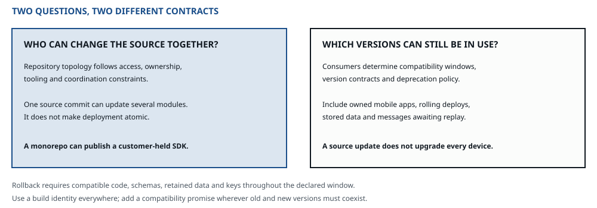

::: standfirst
**A system that cannot be changed safely is not finished, it is finished with.** Most of what we call delivery machinery is never actually decided — a second repository, a version scheme, four environments, a flag framework, they just arrive with the template. And almost all of it can be derived instead. The compatibility windows and the version promises come from one question I asked back in chapter 03 and have been carrying around unspent ever since; the repositories come from another, about source access and coordination; and every environment and flag has to name what it is for.
:::

::: lead
Delivery is what the specification calls its fourth thread — after security, arithmetic and the operating context, the other three concerns that cross every step — and I want to be clear about one thing up front: it is not a phase that starts once the design is done. Half of it was settled in chapter 07, when we cut the boundaries, and its single most important input went on record in chapter 03 — before a single internal component existed.
:::

## One question, and the compatibility promises follow

Chapter 03 asked it, and I deliberately left it unspent: **who holds an artifact of this system that you cannot change and redeploy on their behalf?** A client library, an SDK, a schema, an image, a public API version. Anyone at all.

That is the line between an interface that is merely [public]{.term} and one that is [published]{.term}. The distinction is Martin Fowler's, and every compatibility promise in this chapter descends from it. A public interface you can change, and update every caller in the same commit. A published one you cannot touch that way at all: the calling code is out of your reach, and somebody else decides when to move — or indeed whether to move.

::: figure

A shared source commit and a shared deployment are different things. Published SDKs, old mobile versions, rolling deployments and retained messages can each require a compatibility window.
:::

Every channel declares compatibility. “None” is defensible only when no old consumer, persisted record or retained message can cross the change; deploying both ends from one commit is not sufficient by itself.

**Choose repositories for source access and coordination.** A published SDK can share a repository with its server while following a separate release policy. A commit changes source, not every deployed caller. Team ownership, permissions and cross-cutting change costs belong in the repository decision.

::: primer
#### Version schemes, and the precondition everybody skips

Three schemes, answering three different questions. Picking the wrong one is not fatal. Not knowing which question you are answering is.

- **Semantic versioning** answers *does this break me?* It states its own precondition out loud, and the precondition gets ignored routinely: software using it **must declare a public API**, because the major number is a promise about that boundary. No declared boundary, no meaning.
- **Calendar versioning** answers *how old is this?* The right choice whenever upgrades are driven by support windows, security horizons or regulatory dates rather than by breakage — the consumer wants to know whether they are current, not whether they are safe.
- **A content hash or commit identifier** answers *which exact build is this?* Where both halves deploy together and no consumer can decline anything, this is the honest choice. Its job is identity, not compatibility.

The failure to watch for is a semver scheme whose major number never moves. That is not stability. That is the scheme quietly admitting that nobody was ever in a position to refuse an upgrade — in other words, it was decoration on a build number, and a plain content hash would have told you more.
:::

## A name change is a contract change when consumers can observe it

Retain the old term, its meaning, its replacement and the change date when a published name changes. This adapts the history and maintenance guidance in ANSI/NISO Z39.19-2005 (R2010), §§6.2.3 and 11.3. Add an owner where a supported migration needs one. Documentation aliases keep old terms discoverable; they do not make old executable calls work.

If behaviour stays equivalent, an adapter may preserve the old name through a stated deprecation window. If behaviour changes, document the difference and test each supported contract. Redefining *submitted* to mean *approved* is a break even when its spelling and wire type stay identical. Retained events, replay readers, old mobile clients and rollback versions all count as consumers. Do not make cosmetic breaking renames merely to improve vocabulary consistency; clarify the existing contract and choose the better name when a justified migration can carry it.

## What ships, and where it goes first

Two decisions here, and both weigh rather more than they look.

**The artifact: one per runnable unit, immutable, built once and promoted.** Build it in one place, once, and let every environment receive the same bytes. Identify it by content or by commit, never by a name that somebody can quietly re-point. Build separately per environment and the thing you tested is not the thing you shipped — and keeping the build apart from the run is exactly what makes a release something you can roll back *to*. One check I run every time: if the pipeline emits a deployable the design never named, one of the two is wrong. Delivery does not get to invent a runnable unit.

**Environments are a placement decision, and they are the most reliably uncited mechanism in any system.** Every one of them is a full copy of the cost, the configuration drift, the data problem and the access-control surface. And most of them are there because somebody needed one on a Tuesday in 2019.

So each of them has to answer one question: **what does this verify that production cannot?**

::: example
#### Four environments, and what happened when each was asked

A team runs `dev`, `staging`, `uat` and `production`. Nobody ever proposed this arrangement; they inherited it. So we run the deletion test on each of the four in turn.

- **dev** — verifies that the thing starts and the wiring is right, before anybody else's time gets spent on it. Cheap, ephemeral, no real data. **Cited.** It answers a question production cannot, because production has nothing to say about a build that never got there.
- **staging** — verifies the migration path against production-shaped data, and production genuinely cannot verify that in advance without being the experiment itself. **Cited**, and expensive, and the expense is the point: this is the one environment whose parity is worth paying for, and the answer says why.
- **uat** — ask the question and the honest answer is *it is where the business team looks at things*. But they look at the same build staging already has, on the same data shape, a day later. **It verifies nothing production or staging cannot.** What it really provides is a *calendar* — a slot in the week where people are expected to look — and a calendar does not need its own copy of the infrastructure.
- **production** — not an environment for verifying anything. It is the system.

The finding is not *delete uat*. The brownfield rule applies here, and chapter 11 states it in full: it is a running thing with no recorded reason, so it gets reported as *no recorded reason — confirm before removing*. But the conversation that starts is the right one — and it turns out to be a conversation about a review ritual, not about infrastructure.

**The number that makes it land** is the one nobody had ever computed: a full-parity environment is quite often the second-largest line on the bill after production itself. Four questions found one of those, and the questions took ten minutes.
:::

::: primer
#### Rollout: canary and blue-green answer different questions

**Canary release** — Danilo Sato's — sends a small fraction of the traffic to the new version and compares. It answers *is this version worse?*, and it needs three things before it works at all: a metric to compare on, a population to compare against, and an automatic abort. A canary without an abort criterion is just a slower deploy.

**Blue-green** runs two complete environments and switches between them. It answers *can I get back instantly?* — the switch is the rollback. It costs you a second production-sized environment, and it tells you nothing about whether the new version is worse, because everyone moves at once.

They are not competitors. Blue-green buys you reversal speed, canary buys you evidence. Which one you need, the ladder tells you: if the worst case is a rung the class tolerates, evidence is enough. If the worst case is rung 6, you want the switch.

**And the default is neither.** A plain rolling replace cites no force at all, and most deploys need nothing more than that. Name the force first and the strategy second — the other way round is how a deployment style turns into a house preference.
:::

::: primer
#### Flags have four different lifespans, and mixing them is why they rot

The taxonomy is Pete Hodgson's, and the useful part of it is that each category has a *different expected lifetime* — which means a different obligation to remove it:

- **Release toggles** — hide unfinished work. Lifespan: days to weeks. **Removal is part of the work**, not a follow-up ticket.
- **Experiment toggles** — split traffic to measure something. Lifespan: exactly as long as the experiment, and not a day longer, because a stale experiment sits there quietly biasing your data.
- **Ops toggles** — switch expensive behaviour off under load. Lifespan: mostly short, by Hodgson's account; the kill switches that actuate a rung are the long-lived exception, and deliberately so.
- **Permissioning toggles** — who sees what. Lifespan: very long — often years. This is a product feature that just happens to be implemented as a flag.

**The ops toggle is the one that closes a gap in this book.** Chapter 08 said every rung must be reachable on purpose — by a flag, a breaker or a shed rule. That flag is an ops toggle of the long-lived kind, a kill switch, and this is exactly what the kind is for: *it gives the degradation ladder an actuator.* Without one, a rung is a paragraph in a design document, and the only way to reach it is to have somebody write code — during the incident.

A codebase where all four kinds are the same kind of object, with no expiry and no owner, ends up with hundreds of them and no way to reason about any single one. The taxonomy is the fix, and it costs you exactly one field.
:::

## Desired state, and the drift from it

There is a popular arrangement where the deployed state of a system is described in a repository and a reconciler keeps bending reality to match it. It comes with a name and a set of principles. **This method does not adopt it; it decomposes it** — and I find the decomposition more useful than the name, because it produces three things such setups routinely lack: an ordering rule for the pull, stated commit-to-live and recovery bounds, and drift measured as divergence beyond those bounds, separately from unauthorised mutation.

| The part | Is a | And therefore owes |
|---|---|---|
| **The desired state** | truth **store** | The usual store declarations. It is the truth of what *should* be running, and losing it is not an afternoon's rebuild |
| **The pull** | **channel** | Eight properties, and the one that matters is the **ordering key** — two commits applied out of order is a real failure mode with a real blast radius |
| **The reconciler** | **processor** | Idempotence under replay, like any other processor — and a declared behaviour for when the desired state and the running one conflict |
| **The running system** | a **projection** | A **staleness bound**. How long between commit and live? That is a number, it is promised to whoever is waiting on a deploy, and almost nobody states it |
| **Drift** | divergence with a scope and deadline | Measure unauthorised mutation separately from failed convergence after the allowed transition interval |

Table: Three of the four primitives, one more time — a store, a channel and a processor — and a projection, which is a derived store; and drift, the divergence beyond the commit-to-live and recovery bounds, measured separately from unauthorised mutation. Nothing here is new machinery; it is the same questions asked of a delivery arrangement. {cols="26% 20%"}

The reconciler cites a convergence or recovery obligation. Even the only deployment writer can crash after a partial apply, and a running resource can fail later. Distinguish unauthorised mutation, expected rollout transitions and divergence beyond the agreed commit-to-live or recovery bound.

## Changing something that is already running

Three named shapes, and between them they cover most of what a live system will ever need.

- **Parallel change** — expand, migrate, contract. It preserves rollback while the old data and readers remain usable. Record the rollback window and the point where removing an old representation or accepting new-only writes makes reversal require recovery or migration. A seam and three deployments do not make every step reversible.
- **Branch by abstraction** — put an abstraction over the current implementation, build the second one behind it, move the callers over, delete the first. Inside a single runnable unit, this is the tool.
- **The strangler fig** — new behaviour built beside the old system, behaviour moved across a piece at a time, the old path removed once nothing routes to it any more. Across codebases, this is the tool, and it is the incremental cutover the brownfield rule of chapter 11 demands: *report an uncited mechanism as no recorded reason, and produce a path rather than a deletion.*

What all three share is the one property that makes them usable at all: **the system stays releasable throughout.** A migration that needs a window in which nothing can ship is not a migration strategy, it is a deadline.

::: warn
**Delivery machinery arriving by default.** The pipeline template, the four environments, the flag service, the second repository, the semver scheme — every one of these is a mechanism, and every mechanism cites a requirement — or, where it already runs and nobody can name one, it is reported as *no recorded reason* and confirmed before removal. This is where that rule gets applied least of all, because the machinery never shows up in the architecture diagram; it shows up as a slow build, a coordinated release and somebody's Thursday.
:::

::: thread
#### What the photo system is allowed to buy

The mobile app is owned here but installed elsewhere. An old or offline build can return after the server changes. Record supported protocol versions, a deprecation window and any forced-upgrade refusal. The source repository can remain shared; those consumer obligations still exist.

- **One repository**, justified by source access and coordination for this team. The mobile release, server deployment and thumbnailer remain separate compatibility concerns.
- **No semver.** The version is a commit hash: which build, which trace, which rollback target. A major number would never have moved, and pretending otherwise would have been decoration.
- **Explicit compatibility windows.** Support the agreed mobile versions or return a defined upgrade-required response. For the internal queue, readers must handle every writer schema still retained, including during overlapping releases.
- **Two environments.** A dev environment that verifies the thing starts, and production. Staging was proposed, and got asked the question: with four engineers, one region and no migration path that cannot be run as a parallel change, it could not name what it verified that production could not. So it was not bought — and that is the stop rule doing its job, not the method being skipped.
- **One ops toggle,** and it is load-bearing: *serve originals instead of thumbnails*. That is the actuator for the rung chapter 08 found hiding in the fallback — rung 1, correct but slower — and without it that rung was one sentence in a document. The two rungs chapter 02 actually promised are reached without a toggle: the uploader's rung 4 by chapter 07's shed rule, the viewer's rung 3 by serving the sizes that exist, as-of timestamp attached.
- **Canary, with a named abort metric.** The graded signal exists, and chapter 09 already built it: uploads started against uploads that became viewable, compared between the canary's share of the traffic and the rest. The worst a bad thumbnailer deploy is *allowed* to do is rung 4 — pending, signalled — which the uploader accepted in chapter 02. The worst it *can* do is a thumbnail failing quietly, which is rung 6, and that is exactly what the abort metric is there to catch. Rung 6 would normally want the switch, and it is not bought here for a reason that has a name: the sizes are a projection, the originals are retained truth and the thumbnailer is idempotent, so the way back from a bad deploy is a re-run, not a router. A second production-sized environment on this budget would be paying again for a reversal we already own.

**Almost every line above is a decision not to buy something**, and each one names the constraint that would have justified buying it. That is what delivery looks like when you derive it rather than inherit it: shorter.
:::

::: rule
Delivery is derived, not adopted. Every repository, version scheme, environment and flag cites a constraint from outside — and where the answer is nobody, the honest move is to buy none of it.

The question that decides the compatibility windows and the version promises was asked before any of this existed: who holds something of yours that you cannot rebuild for them? The repositories answer a different one — who needs the source, and who has to coordinate on it.
:::

::: owes
- Specification §02 · [Names carry a scope and a contract](../method.html#naming) — scoped terms, preserved behavioural distinctions and the ANSI/NISO Z39.19-2005 (R2010) adaptation
- Specification [step 04](../method.html#s04) — repo topology and the published-interface test as separate decisions, and the cost to reverse, where parallel change keeps a way back only while the old representation and readers remain usable
- Specification [step 08](../method.html#s08) — the artifact, one per runnable unit, and environments that must name what they verify that production cannot
- Specification [step 09](../method.html#s09) — version scheme, rollout strategy, the three shapes of evolution, desired state and drift, and the four flag lifespans
- Not carried here, and governed by the specification alone: the build system beyond the ecosystem default (step 04); runtime by organisational constraint, the polyglot price and the placement map (step 08); the release row with its rehearsal dates, graceful shutdown as the channel's departure property, migration ordering, configuration as a release and the delivery metrics (step 09)
- The published-interface line was recorded at [step 01](../method.html#s01) and carried unspent from chapter 03 to this one; the cutover shapes are named at [step 09](../method.html#s09), and two of them again at [step 10](../method.html#s10)
- Published Interface is Martin Fowler's own (2003); parallel change and canary release are **Danilo Sato's**; the flag taxonomy is **Pete Hodgson's**. All of it is hosted on martinfowler.com, and those last three were not written by Fowler — see the [foreword](../foreword.html)
:::
