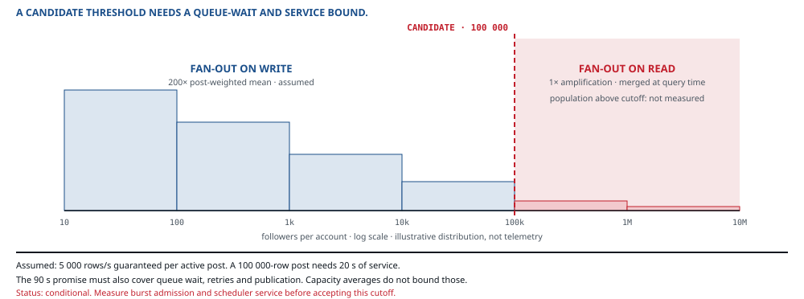

::: standfirst
**The whole method, run once, on a system that breaks through fan-out.** The arithmetic gives a candidate threshold. Its freshness guarantee still depends on admitted load, scheduling and a serving-time age gate; that distinction is what this example makes visible.
:::

::: lead
No primers this time — parts I to IV have already taught the fundamentals. What follows is the ten steps in order, compressed, with the arithmetic left on the page and every mechanism citing something.
:::

## 01 · Outside

| Class | Peak | Latency | Freshness | Accepts | Shed |
|---|---|---|---|---|---|
| **Reader** | [2 500/s]{.num} | p99 [200 ms]{.num} | [90 s]{.num} | rung 3 — stale but complete | last |
| **Poster** | [100/s]{.num} | p99 [500 ms]{.num} | own post: immediate | rung 5 — refuse, clearly | middle |
| **Large account** | rare | as poster | [90 s]{.num} for their readers too | rung 3 | middle |

Table: Demand. Three classes — and the third one is the reason this system is interesting at all.

**Stressed, before leaving the step.** Take the nouns just written and ask what hits each of them. One answer came back worth keeping: a block that is made *after* a post has already been delivered. Hold on to it — step 03 is where it decides something.

**The block contract:** a feed serving decision begun after a successful block acknowledgement excludes that author. The acknowledgement carries a block version; a serving region must read at least that version, or refuse. This is a server decision contract: previously returned pages need a separate client invalidation rule, and offline pixels cannot be recalled. Those client expectations must be agreed explicitly.

**The acknowledgement:** *your post is published.* The user stands there and the flow stops until the system confirms it, and that is what makes this write authoritative: you do not get to acknowledge it optimistically and sort out the truth afterwards.

**The words at the boundary.** These are proposed scope notes for this constructed case, to be agreed with consumers:

| Preferred term | Scope and meaning | Aliases | Distinction from nearby concepts | Source |
|---|---|---|---|---|
| **Published post** | Feed: the authoritative post and its outbox obligation have committed | None declared | Publication does not mean every reader's feed has materialised the post | This case's acknowledgement and step 04 outbox contract |
| **Feed row** | Feed: a derived reference used to assemble a reader's view | None declared | Not the authoritative post or evidence that its author remains visible | This case's step 03 data model |
| **Block acknowledged** | Feed: the block version has committed under the serving contract above | None declared | Not merely an unfollow, and not recall of previously returned pages | This case's block contract |

The 90-second freshness allowance applies to feed assembly, not to permission to ignore an acknowledged block. Those two meanings must remain separate in API results and operational measurements.

**Supply.** One cloud, three read regions and one write region; twelve engineers and an on-call rota. The cost ceiling is [$0.02]{.num} per thousand feed reads, assumed for this worked case. The mobile app is company-owned but independently deployed, so it needs a supported-version window and a defined upgrade-required response. Repository topology remains a separate source-coordination choice.

## 02 · Load

Start with the multiplication, before anything gets named. [8 million]{.num} daily active users, each opening the feed about [6]{.num} times a day, gives [48 million]{.num} reads a day — roughly [500/s]{.num} on average, call it [2 500/s]{.num} at peak. Posting is a far quieter business: [2 million]{.num} posts a day, so [20/s]{.num} average and [100/s]{.num} at peak. **Reads outnumber writes by about 25 to 1**, and that ratio is the fact the whole design turns on.

The follower distribution is the second fact, and this is the one where taking an average throws away exactly the information you came for: median [60]{.num}, mean [200]{.num}, p99 [5 000]{.num}, maximum [40 million]{.num}. **Any design derived from the mean is wrong at the tail** — and the tail is where this system falls over, every single time.

**Data.** A post is about a kilobyte — **assumed** — so [2 GB]{.num} a day of truth, and well under a terabyte a year: small, as step 03 is about to confirm. The working set is whatever the readers who are awake will open next — about a day of feed rows — and it gets its size at step 04, once there is a mechanism to size.

**Provenance.** These are illustrative inputs, not a published production dataset. Volumes, distributions, service rates and recovery times are **assumed** until supplied by measurements. Treat the 90-second target as the proposed product contract; its failure exceptions and sign-off still need recording. No load test is claimed here.

## 03 · Data

- **Views:** the feed ([90 s]{.num}), a profile's posts ([90 s]{.num}), your own posts (immediate).
- **Acknowledgement:** the post is published. Just the one.
- **Invariant:** no post from a blocked account. Again, just the one.

The authoritative inputs are **posts, follows and blocks**. Retain the follow changes or snapshots needed by the chosen membership semantics. Here the proposed rule is to build a feed from currently followed accounts over retained posts; a rebuild uses a consistent follow snapshot plus subsequent changes, and the serving path filters out unfollowed authors. Historical “who followed at publication time” would require historical edges instead. Feed rows are projections only because those inputs survive. Back up and restore all three authoritative classes.

::: warn
**The invariant does not live where you would put it.** The reflex — mine too, the first time round — is to enforce the block down where the feed rows live. It does not hold. A block can be created *after* a post has already been fanned out into somebody's feed rows: the copy is on the mat, and going back round to collect it is a race. So the feed store cannot enforce the block check. It has to be a **read-time filter**, on the path that is otherwise entirely precomputed. One invariant, and it puts work right back onto the hot path that every other decision here was busy trying to keep clear.
:::

## 04 · Storage & transport, and the threshold

Feed rows are keyed reads in a durable key-value store. Posts, follows and blocks are authoritative relational data. A block write returns a version; a read region must establish that version before serving. The latency and availability cost of that check belongs in the read-path sizing.

**Then the sizing pass.** Total fan-out is the sum of each post’s eligible recipients. The account-weighted mean of 200 followers does not establish the post-weighted mean. **Conditionally**, if posts average 200 recipients, [2M × 200 = 400 million]{.num} rows/day, roughly [4 000/s]{.num}. The proposed [20 000/s]{.num} peak and [25 000/s]{.num} service capacity still need a measured burst envelope and load test. A 40-million-follower post plainly challenges that candidate; the ordinary-account distribution can challenge it too.

**Stored bytes and nodes.** A feed row is a reader, a post id and a timestamp — call it [100 bytes]{.num}, **assumed** — so 400 million rows a day is [40 GB]{.num} a day, and at a week's retention and three replicas about [840 GB]{.num}. It is the writes that decide the node count, not the bytes: [25 000/s]{.num} provisioned, three copies of each, is [75 000]{.num} node-writes a second. Against a node taken at [10 000]{.num} writes a second — **assumed**, until a load test says otherwise — and run at half, that is fifteen nodes. Lose one and the other fourteen take [70 000]{.num}, against the [60 000]{.num} the peak needs: N−1, with a little to spare.

Cost per thousand reads falls out of the same sum — the feed store's provisioned write throughput is the largest line of it — and I do not compute it here: that needs a price list, and inventing one is exactly what chapter 04 forbade. It goes on the risk register as a missing input, with its consumer named.

The threshold below is a candidate, conditional on a scheduling and admission contract that still needs testing.

::: figure

A completion deadline contains **queue wait + processing time + publication delay**. Five thousand row writes per second for 90 seconds gives 450,000 rows only if that service is actually available for the entire interval. Reserving one-fifth of capacity for every post is impossible with unbounded concurrent posts. Twenty-four posts of 99,000 recipients require 2,376,000 writes, at least 95.04 seconds at the whole 25,000/s capacity, before background work. The 100,000 cutoff is provisional until burst admission, scheduling, failover capacity and waiting time are specified. Route excess work to a costed read-time path, or report an unmet contract; an alarm is not overflow handling.
:::

**Channels.** The post transaction writes a durable outbox event; producer and each consumer have separate contracts. Delivery is at least once, ordered per author. A bounded work queue has an explicit overflow response: retain accepted events in the outbox and use only an agreed, capacity-tested fallback. Do not silently drop a published post. Expired materialization instructions trigger repair from retained inputs, with an owner and deadline. Readers support all writer schemas retained in the replay window. State group-resolution and rebalance bounds, drain behaviour, redelivery position and lag-based admission limits.

**Granularity.** Two runnable units, and no more than two. The read path and the write path scale on different axes by a factor of 25 — the independent-scaling force at work, doing precisely what it is there to do — and it is the only split bought.

## 05–06 · Trust and derivation

Readers are authenticated and authorized at the surface. Block checks enforce the version contract above and fail closed if freshness cannot be established. Insert-if-absent on `(reader, post)` makes duplicate row creation harmless; deletions and unfollows require versioned filtering so replay cannot restore forbidden visibility. Rebuild from a consistent snapshot of posts and follows plus subsequent changes. The suggested four-hour rebuild is **assumed**, and exceeds the 90-second target: use a parallel rebuild while the old generation stays within its bound, or record the unsatisfied recovery objective. Calling an outage “degraded” does not approve it.

## 07–09 · Failure, placement, operations

- **Freshness at the surface.** A completeness watermark gates the 90-second promise. Beyond it, use only the agreed stale-age limit or a tested fallback; otherwise refuse explicitly. The maximum degraded age and allowed duration are unresolved product inputs, not supplied by an as-of field.
- **Write outcomes.** Refuse before acceptance when the post store is unavailable. If the commit response is lost, return an operation handle and outcome-unknown status; idempotent retry/status lookup resolves it when possible.
- **Read replicas in three regions** cite the reader's p99 and geography, and nothing else.
- **Four numbers watched:** the reader SLO, with an error budget to spend against it; fan-out lag against the 90-second bound, alarmed at 45; the zero-tolerance count of posts shown to blocked readers, found by a continuous out-of-band audit; and cost per thousand reads against the envelope.
- **One outcome KPI:** feeds opened versus feeds that produced an interaction. It is the only thing on the whole list that catches the fan-out quietly ranking badly — a failure that raises no error and moves no percentile.

## 10 · Trace, read three ways

| Requirement | Mechanism | Verified by |
|---|---|---|
| Reader p99 200 ms at 2 500/s | Precomputed feed rows, KV, replicated per region | Per-region read SLO + error budget |
| A published post is never lost | **Post store**, quorum-acked before returning | Durability audit against acknowledgements |
| Feed lags by no more than 90 s | Admission/scheduling contract, watermark and age gate; unresolved capacity proof | Burst, stalled-worker and recovery tests; no passing result claimed |
| Large accounts do not stall everyone | Provisional cutoff plus bounded shared work and costed fallback | Mixed-author burst and failover tests |
| Large-account posts also appear in 90 s | Read-time merge from the **post store** | The same lag metric, on the merge path |
| Serving decisions after block acknowledgement exclude that author | Version-aware read-time filter, fail closed | Cross-region block/read races and unavailable-block-store tests |

{cols="38% 32%"}

**Coverage is declared; sufficiency remains conditional.** The follow history, block-version protocol, admission envelope, scheduler, degraded-age allowance, recovery time and cost inputs must be resolved before this design can be called verified. The table names the tests; it does not report their results.

**Read 3 returns a count of two on the post store**, and the two could hardly be less alike. It carries durability, whose failure is rung 5 for posters, and it carries large-account freshness, whose failure is rung 3 for readers. **One component, two rungs, two client classes** — so the operating floor is set by the stricter of the two, and the rehearsal covers both. That is the finding of this chapter, and a map read twice never shows it to you.

The follower distribution remains useful for workload validation, even though no single percentile decides the cutoff. Obtain the post-weighted distribution and concurrent-post bursts before turning a candidate threshold into a capacity commitment.

::: rule
The hybrid is a candidate architecture. Its threshold is a conditional calculation whose workload, waiting-time and service assumptions must travel with it.

Change the freshness bound and re-evaluate the whole completion budget, including queue wait. Multiplying it by provisioned throughput is not sufficient by itself.
:::

::: owes
- Specification [Naming concepts and contracts](../method.html#naming) — scoped terms, preserved behavioural distinctions and the ANSI/NISO Z39.19-2005 (R2010) adaptation
- The ten steps in order, on a system chosen to break differently from [ticket booking](../worked-example.html) (contention) and the photo thread running through chapters 01–12 (derivation)
- Specification [the ten steps](../method.html#steps) · [§05 · Discipline](../method.html#disc) for the three readings of the map
:::
