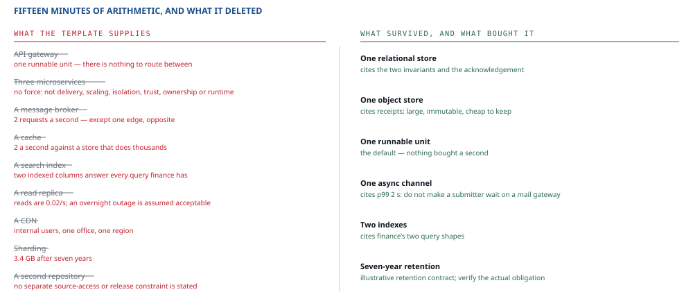

::: standfirst
**Every worked example in every system-design book is large.** And that selection costs us something, because most systems are not large — an engineer who has only ever watched the method run on something enormous will reach for enormous answers when handed something small. I have watched it happen. So this example is deliberately ordinary, and it takes about fifteen minutes.
:::

::: lead
An internal expense-approval tool. Somebody submits a claim with receipts, somebody else approves it, and finance exports the month at the end of it. Nobody is ever going to give a conference talk about this thing — and there are far more systems like this one out there than like the other two.
:::

## 01 · Outside, in four minutes

<table>
  <tr><th>Class</th><th>Peak</th><th>Latency</th><th>Freshness</th><th>Accepts</th></tr>
  <tr><td><b>Submitter</b></td><td rowspan="3" style="vertical-align:middle">~2/s all three combined</td><td>p99 2 s</td><td>own claim: immediate</td><td>rung 5 — refuse clearly</td></tr>
  <tr><td><b>Approver</b></td><td>p99 2 s</td><td>notified within a day</td><td>rung 4 — pending is fine</td></tr>
  <tr><td><b>Finance</b></td><td>minutes</td><td>hours</td><td>rung 3, and shed first</td></tr>
</table>

**Stressed, in one minute.** What hits an approver? Leaving the company with claims still waiting on them. Nobody had said what happens then — a requirement nobody stated, and it goes to whoever owns the process: it gets no mechanism until they answer.

**Invariants.** A claim may not be approved twice. A claim may not be approved by the person who submitted it. Two lines, and both of them buy something later. **Acknowledgement:** *your claim has been submitted* — the flow stops right there, so that acknowledgement has to be durable. **Retention:** assume a seven-year obligation for this case. A real deployment must identify the applicable policy or legal basis, data classes and start-of-retention event; this example does not establish them.

**The vocabulary is small, but one collision matters.** A *receipt* can mean proof of an expense or acknowledgement by this service. Qualify it where both occur:

| Preferred term | Scope and meaning | Aliases | Distinction from nearby concepts | Source |
|---|---|---|---|---|
| **Expense receipt** | Expenses: the supporting document stored with a claim | Receipt, within the expense-document context | Not an acknowledgement that the claim was accepted | This constructed case's document inventory |
| **Claim submitted** | Expenses: claim and notification obligation durably accepted | None declared | Not approval, payment or notification delivery | This case's acknowledgement and outbox contract |
| **Gateway accepted** | Notification: the mail gateway acknowledged the send under its contract | None declared | Not evidence that the approver received or read the message | This case's unresolved gateway contract |

These illustrative definitions expose the delivery question; they do not answer it. Keep *Approver notified* unresolved until the observable event and deadline are agreed. An API called *Approve claim* likewise requests an approval; its result may assert *Claim approved* only after the approval transaction commits successfully under its declared persistence contract, with both invariants checked atomically.

**Supply.** Two engineers, and neither of them full-time on this. The company's existing cloud, in one region, and the company's existing container platform; the users are all internal, in one office. No dedicated on-call — business hours only, and an overnight outage is assumed acceptable, subject to agreement on notification deadlines. Lifecycle: **one-off product**, with a written trigger that would reopen it — onboard a second company and this becomes a different system. Published interfaces: **nobody**. Cost: nobody stated a ceiling, and I did not invent one — the whole footprint is one small database, one bucket and a share of a platform the company already runs, so the honest envelope is *it must not become a line of its own on anybody's bill*. **Assumed**, and worth one email to turn into a number.

## 02 · Load, in three minutes

Four thousand employees, about two claims a month each, so [8 000]{.num} claims a month. Each claim gets viewed or edited perhaps eight times, so [64 000]{.num} reads. Call the lot [72 000]{.num} requests a month; that is [2 400]{.num} a day; and against the [10⁵]{.num} seconds in a day it comes to **[0.024]{.num} requests a second**.

That is the average, though, and the average is not what the month-end afternoon looks like. Month-end concentrates the load — perhaps a third of the month's claims land in one day, and within that day in one afternoon. So round generously and stop arguing: **[2]{.num} requests a second at peak.**

Provenance: headcount and monthly claim rate are illustrative inputs that stand in for an HR/ledger measurement; no dataset is supplied here. Mark all numerical inputs **assumed** until those sources are attached, including peak concentration and item sizes.

Now the data. A claim record is a few kilobytes, which gives [40 MB]{.num} a month and [3.4 GB]{.num} across the full seven-year retention. Receipts are files — two per claim at a few hundred kilobytes each — so around [60 GB]{.num} a year, and [400 GB]{.num} over the seven.

**Now divide.** Two requests a second against one relational node that manages thousands of transactions a second — the ratio comes out at roughly **[2 500×]{.num}**. Then three and a half gigabytes against a disk. And that is where the arithmetic stops, because there is simply no second division worth doing.

## 03–04 · Data, storage, and nine things not bought

Three views to serve: my claims, the claims awaiting my approval, and the monthly export. Every one of them can read the truth directly and be perfectly happy doing it, because at two requests a second the truth store is under no pressure that would justify keeping a copy of anything. **So there are no projections at all** — the first time in this book that has been the right answer, and it is the right answer here for a reason that is written down rather than felt.

::: figure

Nine deletions on the left, six survivors on the right. Not one of the deletions is a verdict on the technology itself — each one names a figure, an answer somebody gave, or the decision above it, and each one reverses the moment that figure, that answer or that decision moves.
:::

One relational store holds the claims, the approvals and the audit trail, and it enforces both invariants into the bargain — because that is where a uniqueness constraint lives, and where the approval transaction can check the approver against the submitter. One object store holds the receipts. And that is the whole storage design.

**One asynchronous notification path survives.** In the same transaction that accepts a claim, create a durable notification/outbox record. A worker sends through the external mail gateway, at least once, keyed by claim and notification version. Bound active sends and waiting work separately; refuse new acceptance before capacity is exhausted rather than discard accepted work. Do not expire pending notifications at one day: that is their target deadline. Track gateway acceptance, retries, bounces and overdue outcomes; a retry may duplicate mail. Cancel a superseded notification only after checking claim state and recording why it is no longer needed. Readers must understand every schema retained in the outbox. The gateway contract and overnight outage allowance must be reconciled with “notified within a day”; until then that delivery promise is unresolved.

## 05–09 · Everything else, in five minutes

- **Trust.** Use the company identity provider plus operation/object authorization: submitters see permitted claims, approvers have delegated scope and cannot approve their own claim, finance has only the agreed export scope. Check approval state and actor in the approval transaction. Authentication alone does not discharge these rules.
- **Runtime.** The container platform the company already runs. **This cites capability, not load** — two engineers should not be operating something bespoke, and chapter 03 wrote that down. A supply-side citation, and a perfectly good one.
- **Failure.** Refuse submissions before durable acceptance when unavailable; return an operation handle and unknown status if acceptance is uncertain. Accepted notifications remain pending or explicitly overdue until a terminal outcome is recorded. Define whether a day means calendar or business time and which overnight failures it allows. Finance shedding also has a stated duration and recovery objective.
- **Operations.** Synthetic submissions measure current availability. Reconcile acknowledged claim identifiers against retained records and exercise backup restoration for durability. Track outbox depth, age, delivery outcomes and overdue notifications separately; queue expiry must not make a failed delivery look successful. Reconcile approval invariants independently.
- **Delivery.** One repository follows the shared source-access and ownership assumptions. Use a commit hash as build identity, and test database/outbox compatibility across rolling deploys and rollback. One additional environment is proposed for restore and migration rehearsals; retain it only if those checks justify its cost. No flag mechanism has a stated obligation in this case.

## 10 · Trace

| Requirement | Mechanism | Evidence required |
|---|---|---|
| Acknowledged claims survive the agreed failure model | Commit before reply, retained records and tested backup/restore contract | Reconcile acknowledgements with retained claims after failure and restore |
| A claim is approved at most once, never by its submitter | Unique constraint on the approval; approver ≠ submitter checked in the approval transaction (or a denormalised submitter column with a composite foreign key and a check constraint) | Nightly reconciliation, zero-tolerance count |
| Submitter sees p99 2 s | One synchronous path; notification made async | Request duration at the surface |
| Approver notified within a day, calendar/business semantics to agree | Durable outbox, gateway outcome tracking and overdue escalation | Delivered/failed/overdue reconciliation; gateway outage exercise. Contract unresolved |
| Finance can pull a month by employee and status | Two indexes on the claims table | Measure export duration under peak interactive load; evidence required |
| Records retained seven years | Retention on both stores, plus lifecycle rules on receipts | Sampled age check against the oldest expected record |

{cols="36% 32%"}

**Six rows declare coverage; they do not certify it.** The role matrix, gateway deadline contract, acknowledgement reconciliation and restoration exercise remain evidence to supply. Sharing the relational store is reasonable, but assess loss of committed data, write unavailability and slow exports as distinct failure modes. No additional service is justified merely by the number of citations.

::: warn
**Reading this as “the method was skipped”.** It was not skipped. It was run, and it stopped early on purpose. The stop rules it took — one node suffices, trust is small enough for an explicit role and object-access matrix — and the two defaults it never had to leave — no force buys a second unit, no view needs a projection — are part of the method, and **taking them is the method working.** What came out is nine deletions with a reason standing beside each one — four figures, three answers to questions somebody actually asked, one parent decision and one constraint nobody stated — and that is a stronger artifact than a diagram of a system nobody needed.
:::

::: rule
Most systems are this one. The method's job here was not to produce an architecture — it was to produce nine reasons not to.

And every one of those reasons is a number, an answer or a parent decision that would reverse the deletion if it moved — which is what makes this a design rather than a shrug.
:::

And that closes the book as it currently stands. Ticket booking sits over at [worked example A](../worked-example.html), and it is the one to read if you want to watch the method being *re-run* — a failed promise forcing the reservation protocol and its observation point to be made explicit, a constructed case of the dependency review described in chapter 12.

::: owes
- Specification §02 · [Names carry a scope and a contract](../method.html#naming) — scoped terms, preserved behavioural distinctions and the ANSI/NISO Z39.19-2005 (R2010) adaptation
- The ten steps on the case the genre never shows — where the stop rules fire and taking them is the method working
- Specification [step 02 · Load](../method.html#s02) for dividing per cluster and per node, and [step 04](../method.html#s04) for the granularity default of one runnable unit
- Specification [§01](../method.html#claim), *how much method to apply* — the stop rules exist to be taken. This is not the single-class service that paragraph gives fifteen minutes and three steps to: it has three classes and an assumed seven-year retention obligation, so all ten steps are walked, and it is short because the stop rules fire along the way
:::
