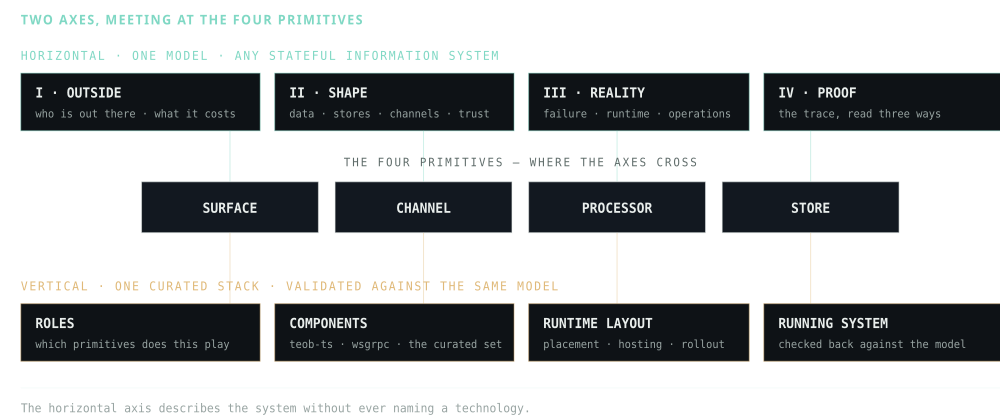

::: section {.hero#top}
::: grid {aria-hidden="true"}

:::

::: wrap
::: eyebrow
the outside-in method · free & open
:::

::: eyebrow
Content revision V4.13 · 2026-10-12
:::

# The end of [*[*human-coded*]*]{.hc} backend

::: h1sub
Harmoniously melting AI, product and engineering together into a holistic, disciplined method.
:::

::: lede {style="margin-top:28px"}
When an agent writes the code, the code stops being the hard part. The hard part is the description it builds from. Product has to be able to argue with it, engineering has to be able to build from it, and the agent must not have to invent anything to follow it. So the description has **three named parts**, and each one has a signature line.
:::

::: sign

the business supplies

<b>The operating envelope.</b> What this organisation can actually run, what it already pays for, what
        may be bought this quarter, and how long the thing is expected to live.

— both sign —

<b>The tolerances. The degradation ladder. The order load is shed in. The cost per request.</b>
        These four head the contract — the specification lists eight — and neither half of the room can set them alone.

engineering owns

<b>The graph and the arithmetic.</b> Which primitives, in what arrangement, and every division that
        justifies them.

:::

::: signcap
**The middle column is the whole point.** It is written in numbers and outcomes rather than in components, so a product manager can argue with it and an engineer can build from it — and when they disagree, they are now disagreeing about the same sentence.
:::

::: cta
<a class="btn btn-solid" href="book/index.html">Read the book</a> <a class="btn btn-ghost" href="#agent">Give it to your agent →</a>
:::

::: promise
**One description of a stateful system that product and engineering can both hold, argue about, and build from.**  four primitives · ten steps · two arithmetic passes · one stress pass · one rule, checked in three directions
:::
:::
:::

::: section {#model}
::: wrap
::: eyebrow
the gap this closes
:::

## Every system is governed by a model. The question is whether anyone shares it.

::: body
Both halves of the room are usually doing their job quite well. Product commits to numbers, because the business genuinely depends on them. Engineering picks mechanisms, because something has to actually run at three in the morning. **What is missing is not care — it is a document where both sets of facts can sit beside each other.**
:::

::: body
Without one, the architecture diagram is drawn in a vocabulary only one side speaks — so it governs nothing: it merely records a decision already taken. Neither half can check the other's work, because nothing they both understand is written in the same terms. And a review with nothing checkable in it gets settled by seniority instead.
:::

::: body
**“Postgres” is not a term the business side can evaluate** — it is an answer to a question they never saw asked. “A store that holds these entities, survives this failure, and is read this many times a second” is a term both sides can hold, and both can then judge whether Postgres satisfies it.
:::

::: body
That is why the model is **implementation-agnostic on purpose**. Not abstraction for its own sake — it is just the only vocabulary coarse enough for someone who does not write code to argue in, and still precise enough to be a real technical structure.
:::

::: two
::: card {.q}
### What only one half can weigh

“We'll use a log for ingestion, a key-value store for reads, a cache in front, split into services.” Technologies appear before any number exists. Nobody on the funding side of the table can tell whether it is right, so nobody argues.
:::

::: card {.q}
### What both halves can weigh

“Partner clients burst [50×]{.num} nightly and tolerate minutes of staleness; end users need [p99 100 ms]{.num} and must see their own orders immediately. So: two client classes, two paths, one truth store, one derived view, and a queue that exists to absorb the burst — remove the burst and the queue goes with it.”
:::
:::

::: body {style="margin-top:32px"}
The second version is not more sophisticated. It is shorter — and every noun in it is attached to a reason a non-engineer can weigh. **That attachment is the entire product of this method.**
:::

::: pull
“The system is a consequence; the clients are the cause. A review should be able to walk any box on the board back to a sentence about a client, or about the organisation that has to run it — and investigate any box with no recorded reason.”
:::
:::
:::

::: section {#vocabulary}
::: wrap
::: eyebrow
one vocabulary, reused everywhere
:::

## Four node types, and the same attributes on both sides of every argument.

::: body
Every architecture is a graph of four kinds of node. Each component declares which kind it is — and each kind owes a different set of answers. Requirements do not live inside the boxes — **they annotate the edges and the surfaces**, and a graph without its annotations is decoration.
:::

::: prims
::: prim
**Surface**Where a client touches the system. Identity originates here; so do the contract, the quota, and which invariants are enforced at this hop rather than deeper in.
:::

::: prim
**Channel**A transfer, with eight answered properties: sync or async, guarantee, ordering key, backpressure, message TTL, schema, far side and departure — plus a latency budget it inherits. The last two are how it fails.
:::

::: prim
**Processor**Derives. Request-time, a stateful stream, a batch or a model — and it must be safe to run twice, with an output that can be rebuilt from something still retained.
:::

::: prim
**Store**A <em>role</em> with constraints, never a product. Truth or derived, with a consistency class and a staleness bound. Postgres is one thing sufficient to play it today.
:::
:::

::: body {style="margin-top:32px"}
Three of those four are relabels of structured analysis, 1977 — and the method [says so on the page that introduces them](method.html#prim). What changed is that the types apply to **roles, not products**: one Kafka is a producer channel, a store with a retention window, and one consumer channel per reader. Three primitives, three sets of properties, three owners — one broker.
:::

### Why this makes a match arguable instead of assertable {style="margin-top:48px;font-size:17px"}

::: body
This is the part that does the real work. **A requirement and a mechanism are described with the same attributes**, so they can be put side by side and checked by anyone in the room — rather than asserted by whoever has been around the longest.
:::

::: tw
| Attribute | What the business says | What the mechanism declares |
|---|---|---|
| {.mono} freshness | “this screen may be **60 s** out of date” | a derived store with a **staleness bound** and a monitor on it |
| {.mono} ordering | “never out of order **within one account**” | a channel whose **ordering key** is the account id |
| {.mono} accuracy | “this count may drift **±2%**” | a processor with a stated **error bound** inside it |
| {.mono} latency | “**99 in 100** under a fifth of a second” | a budget **sliced across the hops** that serve it |
| {.mono} durability | “we lose **nothing** if a machine dies” | a store's **replication mode** and its data-loss window |
| {.mono} invariant | “a campaign **never** spends past its daily budget, even at peak” | a budget held in **escrowed slices**: it may stop one slice short, never run over |

{cols="26% 37%"}
:::

::: body
Read the table across and the argument stops being about opinion. Every phrase in the middle column is one a product owner can say out loud and mean; every phrase on the right is one an engineer can build and test. **The same six words describe what was promised and what was built.**
:::

::: pull
Every mechanism cites a requirement — none recorded, and its rationale needs investigation.  Every requirement maps to a mechanism — none, and it is a gap nobody designed for.  Every mechanism is counted — shared obligations prompt a failure-mode review; the count alone does not establish severity.
:::

### Run the third reading on a box you already have {style="margin-top:48px;font-size:17px"}

::: body
Pick any box on your last architecture diagram — go on, any box — and count the promises it keeps. One question, three different findings — and no second instrument for the second finding.
:::

it keeps …

no promises
No recorded rationale — investigate

Nothing outside the system asked for it. It is still a licence, a deployment pipeline, a line in the
          cloud bill and somebody's on-call weekend, carried for a reason nobody in the room can name.

In a system that is already running, report this as <em>no recorded reason — confirm
          before removing</em>. Never as <em>delete this</em>.

one promise
Cited — check the protocol and evidence

Something outside the system needs it, and if that need disappeared, so would this. That is the only
          one of the three answers that is simply fine.

three promises
Shared — inspect the failure modes

Three promises name this mechanism. Check which fail under each scenario, and which survive through redundancy or fallback.

That is the third reading, and it is the one most methods never make.

::: body
A traceability matrix will happily show every cell filled while one mechanism carries a third of the system, because a matrix asks whether a cell is empty and never how many things are in it. **The instrument is a column count on an artifact you already have.**
:::
:::
:::

::: section {#promise}
::: wrap
::: eyebrow
[horizontal]{.h} × [vertical]{.v}
:::

## The end of backend is not less backend. It is backend that stops being handwritten.

::: figure

The primitives are the pivot — which is why the same vocabulary can serve a product conversation, a storage decision, an on-call rota and a code generator, without ever being translated between them.
:::

### The two axes, crossed at the four primitives {style="margin-top:48px;font-size:17px"}

::: body
Read a row across and one primitive is carried from a sentence about a client to a component that plays it. Read a column down and one phase asks the same kind of question of all four. **Every cell below is a deliverable the specification already names** — the small numbers are its steps.
:::

::: tw {role="region" aria-label="Matrix: the four primitives across the four phases of the model and the curated stack" tabindex="0"}
<table class="xm">
<colgroup><col style="width:11%"/><col style="width:17.5%"/><col style="width:18%"/><col style="width:18%"/><col style="width:17%"/><col style="width:18.5%"/></colgroup>
<tr>
<th scope="col">Primitive</th>
<th class="h" scope="col">I · Outside<small>steps 01–02</small></th>
<th class="h" scope="col">II · Shape<small>steps 03–06</small></th>
<th class="h" scope="col">III · Reality<small>steps 07–09</small></th>
<th class="h" scope="col">IV · Proof<small>step 10 · the trace</small></th>
<th class="v" scope="col">Realised on the stack<small>the curated set</small></th>
</tr>
<tr>
<td class="p">Surface<small>the door, not the outsider</small></td>
<td><i class="st">01</i>The outsider is characterised and never drawn inside — only its door is. Each client class gets a quota and its tolerances.</td>
<td><i class="st">04</i>One surface per client class × operation group: a contract, a sync or async response mode, idempotency on writes. <i class="st">05</i>Where authorisation is enforced.</td>
<td><i class="st">07</i>Every degraded rung promised at 01 needs the flag, breaker or shed rule that reaches it — and when it was last exercised.</td>
<td>Every client tolerance must name its mechanism. None, and it is a gap nobody designed for.</td>
<td class="v"><b>wsgrpc</b> in the set Edge termination for long-lived connections: identity, quota and the streaming contract land in one place.</td>
</tr>
<tr>
<td class="p">Channel<small>a transfer somebody owns</small></td>
<td><i class="st">01</i>Tolerances, one line each: latency per operation as a percentile, ordering scoped to a key.</td>
<td><i class="st">04</i>Every edge answers its eight properties — sync or async, guarantee, ordering key, backpressure, TTL, schema, far side, departure — and inherits a slice of the caller's latency budget.</td>
<td><i class="st">07</i>A failure spec per edge: what it does when the far side is gone. A guarantee that does not survive a partition reopens the data model.</td>
<td>“Never out of order within one account” cites the channel whose ordering key is the account id.</td>
<td class="v"><b>wsgrpc</b> — the transfer behind the door. In the hosting layout, the pull is a channel owing an ordering key.</td>
</tr>
<tr>
<td class="p">Processor<small>derives, safe to run twice</small></td>
<td><i class="st">01</i>Accuracy is a first-class tolerance: a rate limiter may drift ±20 %, a ledger not at all.</td>
<td><i class="st">06</i>A processor list: kind, input, output, state, recovery time, replay behaviour, rebuild duration.</td>
<td><i class="st">08</i>What exactly ships: one identified artifact per runnable unit, and where each one runs.</td>
<td>“This count may drift ±2%” maps to a processor with a stated error bound. One that cites nothing is furniture.</td>
<td class="v"><b>teob-ts</b> public Every behaviour is a processor, replayable by construction — the rebuild path the model demands.</td>
</tr>
<tr>
<td class="p">Store<small>a role, never a product</small></td>
<td><i class="st">01</i>Every view a client reads, with a freshness bound. <i class="st">02</i>How much data accumulates.</td>
<td><i class="st">03</i>Truth or projection, with a consistency class. <i class="st">04</i>A store chosen for the access pattern, with a reason and a sizing table.</td>
<td><i class="st">07</i>Stated recovery objectives. <i class="st">08</i>A placement map: which data classes may live in each region.</td>
<td>“We lose nothing if a machine dies” maps to a replication mode — and a store keeping several promises shows in the count.</td>
<td class="v"><b>teob-ts</b> — the log is the truth store; each projection is a derived store with a stated staleness bound.</td>
</tr>
<tr class="lay">
<td class="p">Runtime layout<small>not a fifth primitive</small></td>
<td colspan="2" style="color:var(--faint)">No technology is named until the demand arithmetic has been divided.</td>
<td><i class="st">08</i>One sentence on runtime, the environment list, the placement map. <i class="st">09</i>A release procedure with its rollout strategy and abort metric.</td>
<td>Drift from the desired state is a zero-tolerance count.</td>
<td class="v"><b>curated hosting</b> internal K3s / Helm: placement, rollout, desired state and drift, decomposed into the same four primitives.</td>
</tr>
</table>
:::

::: xmcap
Rows are the four primitives, where the two axes cross. [Mint columns]{.h} are the horizontal axis — what the model asks of each role, phase by phase, without naming a technology. The [amber column]{.v} is the vertical axis — the component in the curated set that plays the role. The Proof column is where the running system is checked back against the model.
:::

::: three {style="margin-top:44px"}
::: card
### Described once {style="color:var(--mint)"}

In terms both halves of the business can argue about, with a number on every promise and a citation under every box.
:::

::: card
### Realised on a curated stack {style="color:var(--amber)"}

Whose components already declare which primitive roles they play, and what each of those roles guarantees.
:::

::: card
### Checked against the same model

The description that specified it is also the acceptance test — read forward, backward, and by column count.
:::
:::

::: pull {.v}
Backend work does not disappear. It stops being prose that somebody re-derives from memory every time, and becomes a derived artifact — with the derivation still on the page.
:::
:::
:::

::: section {#horizontal}
::: wrap
::: eyebrow
[horizontal]{.h} · coverage
:::

## One model, covering the whole surface of a stateful information system.

::: body
Not a genre of system — any system that holds state and answers to somebody: a marketplace, a ledger, a charging network, a feed, an internal approvals tool. The primitives do not care which, because they describe **roles** — and every one of those systems is made of the same four.
:::

::: body
The ten steps organise the decision record. Discovery may iterate; the final record shows how client promises, retained inputs and arithmetic support each mechanism, together with its evidence and unresolved obligations.
:::

::: phases
::: phase
::: plabel
I · Outside
:::

1. *01*Outside
2. *02*Load
:::

::: phase
::: plabel
II · Shape
:::

1. *03*Data
2. *04*Storage & transport
3. *05*Trust
4. *06*Derivation
:::

::: phase
::: plabel
III · Reality
:::

1. *07*Failure
2. *08*Runtime & placement
3. *09*Operations
:::

::: phase
::: plabel
IV · Proof
:::

1. *10*Trace
:::
:::

### And four areas the runtime picture leaves out {style="margin-top:48px;font-size:17px"}

::: body
Most system-design material stops at the runtime picture — boxes, arrows, a datastore, sometimes a cache. **That is a quarter of the model.** The other three quarters are where the business half of the organisation actually lives with the system, and each one is derived from the same outside rather than bolted on afterwards.
:::

<ul class="ticks">
<li><strong>Observability</strong> — proportioned to consequence, not to what was easy to emit. An SLO is
      a client tolerance with a measurement attached, and some promises have no acceptable failure rate at all.</li>
<li><strong>Operations</strong> — hosting posture, contracts already signed, who is genuinely awake at
      three in the morning, and the cost envelope. Cost shapes a store as firmly as data volume does.</li>
<li><strong>Delivery</strong> — source access and coordination determine repository layout. Deployed consumers, old mobile apps and retained messages determine compatibility and deprecation windows. A shared commit does not make deployment atomic.</li>
<li><strong>Codebase lifecycle</strong> — spike, one-off product, prototype becoming a platform, platform.
      It shapes repo topology and runtime granularity before a line is written.</li>
</ul>

::: pull
“The runtime picture is a quarter of the model. The other three quarters are how it is watched, how it is changed, and who pays for it — and those are the parts the funding side can read without a translator.”
:::

### And one pass that asks what the world might do next {style="margin-top:48px;font-size:17px"}

::: body
Elicitation can miss a workflow such as refunds after a show is cancelled. So the method ends by stress-testing its own description, gently and on purpose: list the surprises together, product and engineering in the same room, no probabilities, nothing too unlikely to say out loud — then watch what the design does with each one. Most surprises bounce off things already built. The ones that do not become **new requirements, findings, or options recorded for later** — designed, priced at a paragraph, and built only when their moment arrives.
:::

::: body
LLM reviews of the constructed ticket-booking case found missing reversal and hold-abuse paths. Prompt contamination limited the earlier runs; an isolated run missed the registered seat-map diagnosis. The [evidence note](evidence/stress-demonstration.html) records these limits. This demonstrates useful review findings, not exclusive discovery or a measured year saved.
:::
:::
:::

::: section {#vertical}
::: wrap
::: eyebrow
[vertical]{.v} · realisation
:::

## One curated stack, whose components are already typed by the same four roles.

::: body
A model you cannot build from is a diagram. The horizontal axis deliberately refuses to name a technology — that refusal is what makes the description shareable and durable. But refusing forever would leave you exactly where every architecture document leaves you: correct, agreed, and not yet a system.
:::

::: body
So there is a second axis. For **a curated set of components and runtime layouts**, the model is executable — because each component in the set is already labelled with the primitive roles it plays, and each carries the properties that role is obliged to declare.
:::

::: tw
| Primitive roles | Component | {.mono} lang | What it supplies to the model |
|---|---|---|---|
| **Surface** + its channel | **wsgrpc** in the set | {.mono} Rust | Edge termination for long-lived client connections. Occupies the door in the boundary and the transfer behind it, so identity, quota and the streaming contract land in one place |
| **Processor** + **store** | [**teob-ts**](https://github.com/teob-cc/teob-ts) public | {.mono} TypeScript | Event-sourced behaviours. The log is the truth store, each projection is a derived store with a stated staleness bound, and every behaviour is a processor that is replayable by construction — which is the rebuild path the model demands, rather than one bolted on |
| **Runtime layout** | curated hosting internal | {.mono} K3s / Helm | Placement, rollout strategy, desired state and drift — decomposed into the same primitives rather than adopted wholesale, so drift is a zero-tolerance count and the pull is a channel owing an ordering key |

{cols="24% 26% 12%"}
:::

::: body
The set is deliberately small. **A curated stack is not a limitation, it is the precondition for validation** — you can only check an implementation against a model where somebody has already done the work of saying what each component guarantees. A component enters the set when its roles and their properties have been written down — not when it is popular.
:::

### Why this is the half that machines are good at {style="margin-top:48px;font-size:17px"}

::: body
Because every mechanism is typed and every figure is quantified, the description is not a diagram. **It is a specification** — and, unusually, one that is also its own acceptance test. The traceability map already states what must be true, so generated work can be *checked* rather than trusted.
:::

<ul class="ticks v">
<li><strong>The model constrains the generation.</strong> An agent implementing against “a derived store,
      60 s staleness bound, ordering per account, ±2% accuracy” has far less room to invent than one
      implementing against a prose ticket.</li>
<li><strong>The model grades the result.</strong> Every mechanism it produced must cite a requirement, every
      requirement must map to a mechanism, and no mechanism may quietly carry three. Those three checks are mechanical.</li>
<li><strong>Provenance survives the machine.</strong> Every figure carries <em>measured</em>, <em>contractual</em>
      or <em>assumed</em>, and an invented number is a finding — which is exactly the failure mode a fluent
      generator has.</li>
</ul>

::: body
**Status, stated plainly.** The horizontal axis is complete and published — the method, the book, eight derivations, and two agent skills that run against a system you already have. The vertical axis is where the work is: teob-ts is public today, the rest of the set and the generation path are being built. This page describes a whole promise and marks which half is delivered, because a page that does not is the same furniture it is warning you about.
:::
:::
:::

::: section {#heritage}
::: wrap
::: eyebrow
rooted, not invented
:::

## Almost none of this is new. What is new is that it is ordered, quantified and checked.

::: body
Three of the four primitives are structured analysis relabelled. Bidirectional traceability and the rule that an unparented requirement is gold plating belong to systems engineering. The deletion test has a parent in TRIZ trimming, and the traceability matrix has one in quality function deployment, 1972. The method's foreword names every one of these on the page rather than in a footnote — it concedes fifteen debts and grades the method's own devices against them.
:::

::: body
The [naming discipline](method.html#naming) carries scoped meanings from client language into APIs, components and their change history. It adapts [ANSI/NISO Z39.19-2005 (R2010), *Guidelines for the Construction, Format, and Management of Monolingual Controlled Vocabularies*](https://www.niso.org/publications/ansiniso-z3919-2005-r2010), while preserving behavioural distinctions that a search vocabulary may group together.
:::

::: heritage
Jackson <i>1995</i>Gane &amp; Sarson <i>1977</i>DeMarco <i>1978</i> QFD <i>1972</i>TRIZ <i>trimming</i>NASA systems engineering Kessler &amp; Sweitzer <i>2007</i>Evans <i>2003</i> Fowler <i>published interface, 2003</i>Robinson <i>2006</i> Nygard <i>2018</i>Sato <i>2014</i>Hodgson <i>2017</i> Johnson, via Fowler
:::

::: body {style="margin-top:26px"}
Every claim about a source on these pages was checked against the source before it was written. **Seven false claims were found that way and corrected**, and three attributions commonly given to Fowler were returned to the people who actually made them.
:::
:::
:::

::: section {#agent}
::: wrap
::: eyebrow
executable
:::

## The same discipline, pointed at a system you already have.

::: body
A method you have to remember is a method you skip at four o'clock on a Thursday. Two skills carry the whole derivation and run against **any** codebase, design document or diagram you put in front of them — not a curated example.
:::

::: code
<pre># add the marketplace, once
/plugin marketplace add teob-cc/teob-method
# install the method
/plugin install outside-in@teob-method
# then, in any repository
/outside-in:review     — audit what exists
/outside-in:derive     — derive what doesn't yet</pre>
:::

::: two
::: card {.q}
### /outside-in:review {style="color:var(--mint)"}

Recovers what is outside the boundary, types every component, runs the deletion test, then reads the traceability map three ways — uncited mechanisms, unmapped requirements, and mechanisms carrying more than one promise — and, where time permits, stress-tests the design for the needs nobody thought to state. The output is a table you can take to a review, not an essay.
:::

::: card {.q}
### /outside-in:derive {style="color:var(--mint)"}

Runs the ten steps forward, refusing to name a technology until the demand arithmetic binds. Produces the artifacts in order — client classes, tolerances, the degradation ladder, data classes, the topology, the failure spec, the operations plan and the trace.
:::
:::

::: body
Both refuse quietly-invented numbers. Every figure they emit carries its provenance, and anything assumed lands in a risk register instead of a slide. In a running system an uncited mechanism is reported as *“no recorded reason — confirm before removing”*, never as *delete this*.
:::
:::
:::

::: section {#read}

read

<h2>Start with the book. The rest is the reference shelf.</h2>
<a class="card" href="book/index.html" style="margin-top:34px;border-color:rgba(127,216,196,.3)">
<h3 style="font-size:19px;color:var(--ink)">Systems, from the outside in</h3>

The method taught rather than specified. It starts at the system boundary, works
      outward to the clients and the organisation, then inward through how data is <em>stored</em>,
      <em>processed</em> and <em>transmitted</em> — and on through what breaks, what to watch, and how to
      change a running system — teaching each fundamental at the moment a constraint makes it necessary,
      and closing every chapter with a worked case and one rule.

Complete — fourteen pieces, five parts →
</a>

<a class="card" href="method.html">
<h3>The specification</h3>

The same method as a dense, searchable rule set. What the skills mirror, and what the book is checked against.

Read →
</a>
<a class="card" href="worked-example.html">
<h3>The worked example</h3>

Ticket booking, through all ten steps — run <em>again</em> when a business count refuses to stay
        at zero, then stress-tested and amended once more. The whole life of a design, on one page.

Read →
</a>
<a class="card" href="derivations/index.html">
<h3>Eight derivations</h3>

The method organised by what it <em>does</em> — the division, the stop rule, the invariant, the
        channel — each illustrated, with its assumptions and source-verification limits.

Eight devices →
</a>
<a class="card" href="foreword.html">
<h3>The foreword</h3>

Where this came from: fifteen debts, three devices with no owner found, and the six best arguments against the whole idea — one removed the paper's headline claim, and the newest was answered by adoption.

Lineage →
</a>

:::

::: section {#start}
::: wrap
::: eyebrow
start
:::

## Don't start with the method. Start with one question.

::: lede {style="margin-top:22px"}
If you build the system: open your last architecture diagram, pick any box, and count the promises it keeps. None means you have found something worth a conversation; three means you have found the thing most worth protecting. And either way, the next design review just became easier.
:::

::: lede {style="margin-top:14px"}
If you own what the system is for: ask to see the middle column — the tolerances, what customers get on a bad day, who is served first when there is not enough to go round, and the cost per request. That page is written in your language on purpose, **because half of it is yours to sign**.
:::

::: cta
<a class="btn btn-solid" href="book/index.html">Read the book</a> <a class="btn btn-ghost" href="#agent">Install the skills →</a>
:::

::: promise
free · no signup · nothing to buy · the method and its agent skills are MIT
:::
:::
:::
