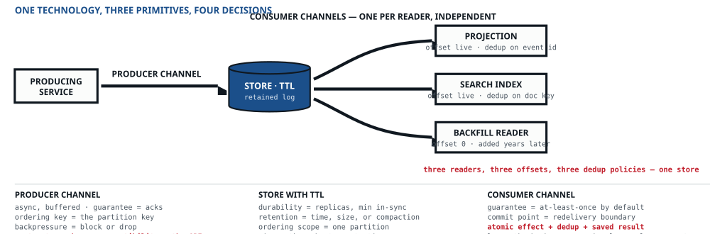

## Four primitives — the architectural vocabulary

::: lede
Every architecture is a graph of four node types, and naming them is what keeps the language honest: each component must declare which type it is, and each type answers a different set of questions. Requirements don't live inside the boxes — **they annotate the edges and the surfaces**, and a graph without its annotations is just decoration.
:::

### Where the four came from — three of them are renames

This is best said here rather than hidden in a footnote. Structured analysis fixed this vocabulary in 1977: Gane & Sarson, then DeMarco a year later, type every element of a system as a **process**, a **data flow**, a **data store** or an **external entity** — and they build the context diagram literally outside-in: name the flows, name the external entities that sit outside the system, draw the system as one box, arrange those entities around it. Three of the four primitives below are that model, relabelled.

| Structured analysis, 1977 | Here | What actually changed |
|---|---|---|
| Process | **Processor** | Nothing of substance. A rename |
| Data flow | **Channel** | Promoted from a line to a contract: **eight** declared properties, one inherited budget, and a named owner. A data flow is something that happens; a channel is something somebody owns |
| Data store | **Store** | A rename, plus the insistence that the word names a *role* and never a product |
| External entity | **Surface** | Not a rename — a substitution, and the one composite type |

{cols="20% 16%" style="margin-top:8px"}

But two things diverge, and they are why this is a different instrument rather than the same one in a costume.

**The fourth type is a substitution.** A data-flow diagram's fourth element is the outsider itself — the customer, the partner system, the bank. Here the fourth element is the *door*: the surface that system exposes to the outsider. Outsiders are characterised in the first step and never drawn inside the boundary — what goes on the graph is the touchpoint. A surface is also the only **composite** primitive — take one apart and you find a channel and a processor — but four properties survive the decomposition and are lost if you model it as its parts, which is what the second panel of the figure below is about.

**And the types apply to roles, not to products.** This is the sharper break. A data-flow diagram types the symbols you draw, one apiece. These four are asked of every product you deploy instead — and one product routinely occupies several nodes at once. **Kafka is a producer channel, a store with a retention window, and one consumer channel per reader**: three primitives, three sets of properties, three different owners, one broker. A database with change data capture is a store *and* a producer channel. An object store behind a CDN is two stores, a channel between them, and a surface in front.

::: say
The question is never “is this thing a store?” It is **“which roles does this thing play, and does each role carry its own properties?”** Most designs discover at exactly this point that they promised something they never specified.
:::

::: figure

:::

### The questions each type must answer

| Primitive | Purpose | Legal questions — unanswered means undesigned |
|---|---|---|
| **Surface** | Where a client touches the system | Authn/authz and at which hop · request contract and versioning · quota and rate limit per client class · which invariants are enforced here · pagination and partial results · idempotency on writes · server-initiated push (webhooks, sockets): signing, redelivery, ordering |
| **Channel** | Moves data between nodes | **Eight answered**: sync or async · delivery guarantee · ordering key · backpressure behaviour · message TTL · payload schema and compatibility mode · far side · departure. Answered rather than always chosen — the first decides how much content two of the others carry, and “not applicable, this is synchronous” is an answer to be written down rather than skipped. **One inherited**: the latency budget, sliced from the caller's |
| **Processor** | Derives data from other data | Request-time, stateful stream, batch, or model · state size and recovery time · idempotent under replay · keying and parallelism · late/out-of-order handling · rebuild path |
| **Store** | Holds data | Truth or derived · durability and replication · **consistency offered** — what each reader *takes* off that menu is a property of the reader's channel, not of the store · query shapes served · lifecycle and TTL · size, growth, and hot-key profile · where more than one process plays it, **the channels between them** — replication and membership — from which its durability and its consistency offered follow |

{cols="15% 22%"}

### Decomposing a technology into primitives

::: lede
Naming a technology once is how a design smuggles in unexamined decisions. The log is the standard example: it is not a channel that happens to store things — it is a **producer channel**, a **store with a TTL**, and one **consumer channel per reader** — three primitives, each carrying its own properties, each with a different owner.
:::

::: figure

:::

::: grid2 {style="margin-top:12px"}
- **Three primitives, three owners.** The retention window belongs to the store, the ordering key to the producer channel, and the deduplication key to the consumer channel. A single label collapses three decisions into one shrug — and the shrug is always the same one: nobody specified deduplication, because the broker was assumed to have handled it.
- **One store, many consumer channels.** This is exactly what separates a log from a queue: a queue's store has a per-message lifecycle, so acknowledgement deletes, while a log's store is retention-bounded and each reader holds its own position. Fan-out, replay, and adding a consumer three years later are the same fact stated three ways.

* **The schema is the fourth decision, and the one most often skipped.** On an async channel the payload schema is not *a* contract, it is **the** API — there is no other interface. It gets a fraction of the ceremony a REST endpoint gets, for a structural reason rather than a careless one: an HTTP caller appears in your logs, while a topic's consumers are invisible at write time. So the compatibility mode is chosen by default rather than by decision, and the readers it breaks are the ones nobody could see — the indexer added next year, the backfill replaying from offset zero. Name the schema, the compatibility mode, and an owner on the edge, or the design has published an API by accident and promised nothing about it.
* **And the store in the middle has an inside.** The retained log is replicated across brokers, and between the replicas runs a channel of its own, with its own eight answers and nothing on the drawing to show it. Step 04 says what it owes.
* **Neither a cache nor a queue is a fifth primitive.** A cache is a derived store with an invalidation contract — calling it that forces the staleness question component-first designs skip. A queue decomposes exactly as the log does, and without a stated guarantee and backpressure policy it is a place where messages go to be forgotten.
:::

### Where the boundaries are — and what each crossing costs {style="color:var(--ink2);font-size:12px;margin:16px 0 2px"}

An edge is not a fixed thing. The very same arrow between the very same two responsibilities carries local contracts, eight properties, or twelve, depending only on *which boundary it crosses* — and that is decided when storage and transport are chosen, not here. This is why granularity is a phase change rather than a refinement: it decides how many of the edges on your graph are channels at all.

::: figure
![Two panels. The first shows an edge crossing three kinds of boundary: inside one runnable unit it is a function call that still needs explicit local contracts; between runnable units it is a channel acquiring eight properties, two of which are the failure mode; across the system boundary it is a surface, acquiring identity origination, quota policy, an external contract and invariant enforcement. The second panel explodes a surface into its channel part, its processor part, and the four properties neither can express.](../figures/02-boundaries.svg)

THE EDGE IS NOT A FIXED THING · WHICH BOUNDARY IT CROSSES DECIDES WHAT IT COSTS
:::

::: grid2 {style="margin-top:10px"}
- **A channel exists wherever a transfer needs an independent contract.** A network boundary always does; an in-process asynchronous queue also needs ordering, capacity and failure behaviour. A direct function call can be represented as an internal edge, but concurrency, deadlines and effects still have to be reasoned about. Co-location does not create a transaction.
- **A surface is a channel and a processor — plus the part that does not reduce.** The decomposition above is correct and worth doing; the four properties in the red box are what survive it. Identity is *minted* at a surface rather than carried across it. Its contract changes on a deprecation window rather than a deploy. Its quota expresses who deserves what — decided when the outside is characterised — where backpressure only reacts to load. And invariants are refused there, which no channel can do, because channels transfer and do not decide.

* **Every boundary crossing is a surface; ownership decides the direction of authority.** Yours you enforce at. A payment processor's API is *theirs* — your side of it is a channel to a door you do not control, which is why the outside step records what such a dependency *grants* you rather than what you enforce there. Confusing the two is how a design ends up assuming it can rate-limit somebody else's service.
* **Edges and surfaces carry the requirements.** Budgets, guarantees and staleness bounds annotate the edges; quotas and enforced invariants annotate the surfaces — together they are the part of the drawing that can be wrong, which is what makes them the valuable part.
:::

### Names carry a scope and a contract {#naming}

The four primitives type architectural roles. The domain still needs names for the things clients ask about: a seat, a hold, a booking, a payment. Carry those meanings from the client table into the data model, surface contracts, diagrams and observations. If a word changes meaning along that path, a trace can look complete while joining different promises.

**Source:** [ANSI/NISO Z39.19-2005 (R2010), *Guidelines for the Construction, Format, and Management of Monolingual Controlled Vocabularies*](https://www.niso.org/publications/ansiniso-z3919-2005-r2010). It governs vocabulary for indexing and retrieval. The rules below adapt its term selection, scope, relationships, testing and maintenance to system descriptions; the API and compatibility consequences are TEOB's application, not requirements stated by NISO.

| Naming rule | What the design records | Source sections |
|---|---|---|
| **Use language with a source** | Choose terms from client usage, domain documents and the organisation's established language. Record which source supports a disputed or unfamiliar choice. An invented term remains a proposal until its meaning is agreed; neither a popular word nor an internal preference settles a disagreement about behaviour. | §§5.3.5, 6.6.1 |
| **Prefer one term per concept, within a scope** | State the domain in which the term holds, choose its preferred form and record aliases. Different domains may legitimately use different meanings; map them at their boundary. A shared spelling is not evidence of a shared concept, and an alias in documentation does not promise a second supported API endpoint. | §§5.3, 6.2, 8.2 |
| **Resolve ambiguity at the point of use** | Use a natural compound or an explicit namespace where meanings meet: `AccessToken`, `PageCursor`, `AdmissionPermit`. Qualify each conflicting sense. A short local name is sufficient where its scope is visible and unambiguous. | §6.2.1 |
| **Write the boundary of the meaning** | A scope note states what the term includes and distinguishes it from nearby terms. Define *accepted*, *committed* and *completed* by the condition each reports. Define *unknown* as what this observer cannot establish; it is not evidence of a pending operation or a refusal. Cross-reference both sides of a distinction. | §6.2.2 |
| **Keep meaningful compounds and recognisable forms** | Use natural word order and modifiers that narrow a concept: *seat hold* identifies more than *hold*. Keep established compounds intact. Prefer full forms unless an abbreviation is established and unambiguous for these consumers. Apply the language's identifier conventions separately; NISO's indexing rules for noun forms do not prescribe API verbs, casing or plural resource paths. | §§6.3.1, 6.6.2–6.6.4, 7.4–7.5, 7.8 |
| **Type the relationship too** | Distinguish *is a kind of*, *is an instance of*, *is part of* and *is related to*. A payment associated with a booking is not therefore a kind of booking. Vocabulary relationships alone justify neither software inheritance nor a runtime split. | §§8.3–8.4 |
| **Retain meaning through change** | For published terms, record the previous form and scope, the change date, reason, owner and replacement where one exists. Separate a label change from a meaning change. Trace effects on clients, stored schemas, retained messages, metrics and historical records before choosing the migration and compatibility window. | §§6.2.3, 11.3 |
| **Test the vocabulary on tasks** | Ask representative consumers to select an operation for a concrete task and explain what its response establishes. Record who was asked, the task, disagreements and revisions. Until performed, this is a proposed check, not validation. A naming review cites the conflicting usages or name–contract mismatch and its consequence; unfamiliar style alone is not a correctness defect. | §11.2 |

{cols="22% * 16%"}

**Keep a small vocabulary table where meanings affect a promise:** preferred term · scope and meaning · aliases · distinction from nearby concepts · source. Unresolved choices stay marked *unresolved*, with who can settle them. Put this beside the affected client or contract table; do not invent a global dictionary or catalogue every local variable. Add ownership and history where publication or change makes them necessary.

::: warn
**Retrieval equivalence is not behavioural equivalence.** NISO §§8.2.3–8.2.4 permit near-synonyms and broader terms to stand in for narrower ones for retrieval. A documentation search may connect *cancel* and *refund*; an executable contract must retain their distinction where one stops an obligation and the other returns money. Do not merge states, operations or permissions because their names are related.
:::

**Name the responsibility; declare the role; record the implementation separately.** *Seat availability view* is a domain responsibility played by a derived store. Its product belongs in the implementation column. A runnable component playing several primitive roles gets several role entries, not an invented fifth primitive. Different role names do not require different processes.

**Let operation and result names follow the contract.** An illustrative `RequestSeatHold` asks for a transition; `SeatHeld` reports the specified hold only after it exists. Neither spelling supplies atomicity, durability or authority. Refusal, known pending work and an outcome unknown to the caller remain distinguishable in the contract. Existing public names are assessed for consequences and changed through compatibility rules, not renamed for cosmetic uniformity.

### Where the vocabulary comes from {style="color:var(--ink2);font-size:12px;margin:16px 0 2px"}

**Three of these four are renames, and the fourth is the argument.** Processor, channel and store are *process*, *data flow* and *data store* from structured analysis — Gane and Sarson, 1977, and DeMarco, 1978 — and the discipline of asking a different set of questions of each type generalises Shostack's per-element threat enumeration from security to every constraint class. The substitution is the fourth: where a data-flow diagram's remaining type is the **external entity**, the outsider itself, this method's is the **surface**, the door the system exposes to it. An external entity is something you *characterise*; a surface is something you *build and enforce at*, which is precisely what the exploded view above shows. Outsiders are characterised in the first step and never drawn inside the boundary. **A vocabulary this old is a feature**: it means the typing is not the contribution, and the ordering is.
