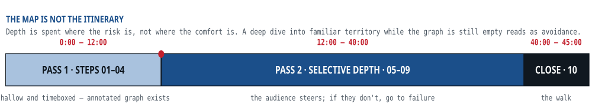

## Running the method in forty-five minutes

::: lede
Ten steps executed linearly at full depth will eat an afternoon — correct for a design document, fatal in a 45-minute conversation. So run two passes over the same map: a shallow one that puts a complete annotated graph on the board, then selective depth wherever the audience steers.
:::

::: figure

:::

### Same method, three artifacts

::: grid3
::: card
#### Interview

Announce the plan in the first thirty seconds — it buys steering rights for the whole conversation. Two passes as above. Checkpoint every ten minutes with one sentence of summary and one steering question. Say two numbers out loud on the way: the hottest key's ratio and the fan-out tail. Close with the walk, the two risks, and the first experiment.
:::

::: card
#### Design document

The ten steps become the section headings; each step's deliverable becomes its content. The traceability map goes at the front, not the back — it is the part reviewers can disagree with productively, and it makes the review about evidence.
:::

::: card
#### Talk or article

Claim, then the deletion test, then the four primitives, then one worked example carried end to end, then the map. The anti-patterns land best late, once the audience has a vocabulary for recognising them in their own last project.
:::
:::
