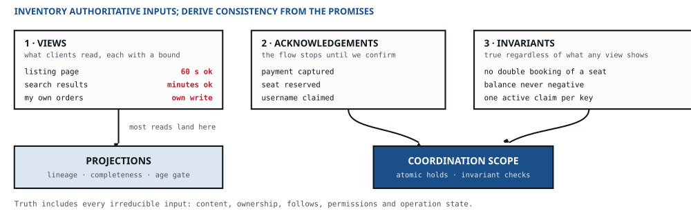

::: def
Model views, acknowledgements, invariants and irreducible inputs. Retain every authoritative input needed to reconstruct the promised state; choose consistency and coordination separately from authority.
:::

::: asks
ASKS · Which views do clients read and how stale may each be · which writes must be authoritatively confirmed before the flow continues · what must never be violated regardless of any view?
:::

**Bind the vocabulary to the data.** Extend each relevant term with its identity and scope, state or lifecycle condition, authoritative source and distinction from a projection. Write the terms used by invariants and acknowledgements consistently. Record concept relationships explicitly: association, containment and kind are different claims. The data-class and acknowledgement tables carry these meanings forward.

::: figure

:::

### 1 · Views first {style="color:var(--blue);font-size:12.5px;margin:14px 0 4px"}

The reads and their freshness bounds were declared at step 01. A view can be a projection only when its complete inputs are retained and its serving protocol meets that bound. A permissive freshness target allows a projection; it does not prove that one exists or that its inputs are reconstructible.

Designing the read side first keeps the derivation pointing outward — clients touch views, not tables. It also produces the correct default: **a view is a projection unless something forces otherwise**, which inverts the usual habit of serving every read from the transactional store because it happens to be there.

- **Merge views that share a key and a freshness class.** A projection per query is a cost, not a design: each one adds a processor, a store, a lag metric, a rebuild path, and one unit of write amplification when the sizing pass runs.
- **Shape each view for its access pattern.** Denormalise freely — a projection has no duty to be normalised, only to be rebuildable.

### 2 · Acknowledgements — the narrow blocking set {style="color:var(--blue);font-size:12.5px;margin:14px 0 4px"}

Now find the writes where the client cannot proceed on a maybe. The test is behavioural, not sentimental: **if this call returned “probably”, would the next screen be a lie?** Booking a seat, taking a payment, claiming a name — the user is about to be told something happened. Everything else can be accepted and completed behind them.

Then be precise about *what* is being confirmed, because the three kinds differ by an order of magnitude in cost:

| Kind | Guarantees | Costs / typical use |
|---|---|---|
| **Receipt** | Durably recorded and will not be lost; an idempotency key comes back; the work completes later and the client is notified | One durable append. Orders, uploads, submissions, most “we've got it” flows |
| **Reservation** | A contended resource is held for this caller now, usually with an expiry | Needs the strict store and the invariant that guards it; contention concentrates on hot keys. Seats, inventory, unique names |
| **Completion** | The final state is reached at the moment of the response | The expensive one, and frequently unnecessary — payment capture and settlement are usually a receipt plus asynchronous completion plus a notification, which users accept when the interface says so |

{cols="16% 34%"}

::: warn {style="margin-top:8px"}
Treating “must be reliable” as “must be synchronous”. Reliability is durability; synchrony is a user-experience decision. Conflating them is what drags an entire write path into the strict store, and with it every scaling problem that store has. The kind chosen here is also carried forward: an acknowledgement the caller's own promise depends on makes that edge **commit-bearing** at step [04]{.num}, and half the mechanics at step [07]{.num} become illegal on it.
:::

### 3 · Invariants — the part no view can tell you {style="color:var(--blue);font-size:12.5px;margin:14px 0 4px"}

Views describe what clients want to see; they say nothing about what must never happen. Uniqueness, non-overlap on a calendar, a balance that cannot go negative, a state machine that only moves forward, referential rules between entities. This pass is not optional after the read-first move — it is precisely the thing the read-first move cannot surface.

- **Each invariant names a scope — per entity, per tenant, or global — and one authoritative enforcer per promise it carries.** Most carry one promise; an invariant held at the bounded rung below carries two, the bound and the exact figure, and each has its own enforcer. Redundant checks are legal — a database constraint beneath an application check is defence in depth — but only when they name the authority; three components that each believe they decide means none does.
- **Global invariants are the expensive ones.** Challenge each: an invariant scoped to a single entity is a row lock, while one scoped across all entities is a distributed transaction wearing a disguise.
- **The invariant determines the transaction protocol.** A conditional write suffices when all relevant state and checks fit its atomic scope. Across several records, use serializable transactions or another demonstrated locking/constraint protocol; snapshot isolation alone can permit write skew, as with two doctors independently leaving an on-call rota. Record the store’s configured isolation. Across partitions, consider a distributed transaction, a different data placement, or a protocol that preserves the invariant. A saga is acceptable only when intermediate violations are explicitly permitted; compensation alone bounds neither their amount nor their duration.

::: p {style="margin-top:10px"}
**An invariant has a ladder of its own — the enforcement ladder.** The degradation ladder of step 01 is what a *client* is handed when the system cannot deliver; the enforcement ladder is how strictly an *invariant* is held under concurrent writers. Two ladders, never merged.
:::

| Rung | How | Violation | Price |
|---|---|---|---|
| **E1 · Serialised** | Every change checked at one serialisation point, at the isolation its scope sets | None | Contention and coordination; measure the enforcing protocol at the hot key |
| **E2 · Escrowed** | The quantity is split into slices held by the writers; each spends its slice locally and refills from the serialisation point | None — the bound holds exactly | Slack stranded in slices: a request may be refused while capacity sits in another writer's slice. Escrow turns overshoot into undershoot |
| **E3 · Bounded** | Writers check a lagging view; an exact reconciliation runs afterwards and compensates | A proved bound under stated admission, lag and in-flight limits; averages do not establish it | The overshoot, priced against its loss line, plus the reconciler |
| **E4 · Detected** | No check on the path; an audit finds violations and compensates | Unbounded until the audit runs | Every violation, priced — legal only where each one is cheap and reversible |

{cols="15% 31% 20%"}

- **Take the cheapest rung whose worst-case violation, priced per unit against its loss line, fits what the signatories accept.** An invariant whose violation is the degradation ladder's sixth outcome — `wrong`, never permitted: a seat sold twice, a balance below zero — may use E1 or E2 only. The bound accepted at E3 is an **accuracy tolerance**, already first-class at step 01, and it is signed the way every tolerance is.
- **E2 can reduce coordination for divisible rights.** Allocate disjoint rights durably, debit them atomically, and fence former holders before reassigning rights. A timed-out holder may still be spending; reclaiming its slice without fencing can overspend. Price stranded capacity and refill traffic using the measured protocol. Escrow is a candidate for additive budgets, not a generic replacement for every contended invariant.
- **One enforcer per promise, not per invariant.** At E1 and E2 an invariant carries one promise. At E3 it carries two: the **bound**, enforced on the path, and the **exact figure**, enforced by the reconciler — a processor at step [06]{.num} with a deadline of its own, and the enforcer of record for anything billed. At E4 the path checks nothing, and the audit is the only enforcer. Each promise still has exactly one.
- **E3 needs a bound that remains true during failure.** For an additive quantity, a hard maximum admitted rate in quantity units times a hard maximum visibility delay can bound unseen increments only after accounting for bursts, concurrent checks, in-flight work and per-operation size. Stop or change the contract before either bound is exceeded. Reconciliation needs a completion deadline and a response when it cannot meet it. A lag alarm and average rate do not supply these limits.

{style="margin-top:8px"}

::: p {style="margin-top:10px"}
**Authority and consistency answer different questions.** Inventory every irreducible input, including imports and user-maintained relationships. A projection is derived only if its complete inputs, versions and required history remain available for a rebuild. Acknowledgements and invariants decide which operations need strict coordination; they do not decide which data exists independently. Authoritative data can have eventual visibility. Name the retained inputs first, then choose durability, consistency and isolation separately for each class.
:::

### The seam between the two — read-your-writes {style="color:var(--blue);font-size:12.5px;margin:14px 0 4px"}

A client that happily tolerates a stale world rarely tolerates staleness of *its own* effect. The acknowledgement returns, the interface navigates to a view, the view lags, the change appears missing — and the user retries, which is how duplicate orders are born. Annotate every view with whether it must reflect the caller's own recent write, and fix it in this order: **return the resulting entity in the write response** (cheapest, and usually sufficient), then pin that caller's session to the authoritative read, and only as a last resort make the projection synchronous — which converts a cheap view into an expensive one and should be argued for, not slipped in.

### The other seam — views a client *commits* against {style="color:var(--blue);font-size:12.5px;margin:14px 0 4px"}

Read-your-writes covers a client seeing its own effect. There is a second case, and it is the more expensive one: **a view the client makes an irreversible or contended choice from**. A seat map before a purchase, an inventory count before an order, a username field before a claim. Here staleness does not read as a stale page — **it converts directly into a broken promise**, because the interface showed something available and the commitment is then refused. The user was not shown old data; they were told something false at the moment they acted.

Mark the view a client acts on and the point where the interface promises a result. **An authoritative read removes replica lag, not the interval before a later write.** Two buyers can both read an available seat from a linearizable store; only one can reserve it. Use an **atomic conditional reservation** when selection must hold a resource, return its identifier and expiry, and make checkout conditional on that hold. Browsing may remain a projection. Before a hold is acknowledged, a clear refusal is legitimate; after it, the accepted contract governs. A stricter view alone cannot make the race impossible.

What is not legitimate is the fourth option, which is what most designs do by default: keep the projection, promise nothing about it, and let the refusal arrive as a surprise at the moment of payment. That is the case the **zero-tolerance count** at step 09 exists to catch, and a sustained non-zero there sends you back to this paragraph.

### Then, per data class, record {style="color:var(--ink2);font-size:12px;margin:16px 0 2px"}

- **Consistency class per category**, the weakest that satisfies the client tolerances — see the table below, and the order beneath it. The label is a promise, and each promise has a price.
- **Ordering is always scoped to a key.** Per-entity, per-session, per-partition. Global ordering should be rejected explicitly and audibly; if someone needs it, that requirement now has to be defended on its own.
- **Conflict policy, required wherever a class has more than one writer** — or accepts writes offline, which is the same thing with a delay. The consistency table below ends before this case: it says what a reader sees, not what happens when two writers disagree. Name one of last-writer-wins on a stated clock · version vectors · a convergent type · an application merge rule · or a conflict surfaced to a human. “It won't happen” is a policy too, and it is wrong; the step-01 client list already told you whether the client is offline-capable.
- **Sensitivity classification** per class — public, internal, personal, sensitive-personal, regulated — together with residency constraints and the erasure obligation attached to each. Classification is a property of the data, so it is decided here; what enforces it is decided later. Derived classes inherit the strictest classification of their inputs — and a join of two public fields can become identifying, so classification is re-checked at the projection, not assumed from the parts.
- **Minimisation.** The cheapest privacy control is the field that is never collected, and the second cheapest is the one discarded early. Ask which attributes the system genuinely needs before asking how to protect them.
- **Lifecycle to the end — and the end comes in two kinds.** *Temporal*: the data expires against a clock, through retention windows, regulatory minimums, legal holds, or a TTL. *Custodial*: the data has no natural expiry and stays valid until the entity that owns it is retired — a tenant offboarded, an account closed, a product delisted. For custodial data, “keep forever” is the correct answer, and the deletion trigger is an event elsewhere in the system rather than a clock. The liability was never retention itself; it is retention with **no owner and no exit condition** — or, just as bad, a retirement cascade that nobody has ever executed.
- **Orphans are the custodial failure mode.** When the owner is deleted and the cascade only half-completes, you are left holding personal or commercial data with no legal basis and nobody left to ask about it. Offboarding is a workflow that runs rarely, is tested less, and fails quietly; give it a named owner, a completeness check, and a rehearsal, exactly as you would a restore.
- **Deadlines run on somebody's clock.** Retention windows, erasure deadlines, TTLs, and lease expiries all assume a time source; record which one each relies on and what skew does to it.
- **Quasi-static reference data is a class of its own.** Tenant settings, pricing rules, feature flags, taxonomies, templates, permission schemes — the control plane rather than the data plane. Its profile inverts event data: written by a human a few times a month, read on nearly every request, large in aggregate because it multiplies by tenant, and growing with the customer list rather than with traffic. Three consequences are worth recording now. Staleness here is a **correctness** bug rather than a freshness inconvenience, because an unpropagated price or flag produces confident wrong answers. It wants **version history, diff, and rollback**, since a bad configuration change is among the most common causes of outages and reverting is the fastest fix. And it is usually **truth rather than projection**, so it needs its own backup and restore path instead of being rebuildable by replay.
- **Shape and size**: item size, cardinality, growth rate, and the hot-key profile — one celebrity entity can dominate the access pattern of an otherwise uniform data class. The profile is consumed, not merely recorded: the per-key division at step [02]{.num} sets each hot unit's enforcement rung above.

| Consistency class | Means | Costs | Typical fit |
|---|---|---|---|
| **Linearizable** | Every read sees the latest committed write | One authoritative ordering point per operation — a fenced leader, or consensus; the latency floor rises with distance | Balances, uniqueness, locks |
| **Sequential** | Every reader sees the writes in one agreed order, though not necessarily the latest | One ordering point — a leader or a totally ordered log — without a real-time read path | Coordination and configuration data read from followers |
| **Causal** | Effects are never visible before their causes | Session tokens or version tracking on the read path | Comments, collaboration, conversation-shaped data |
| **Read-your-writes** | A client always sees its own effects | Session pinning or read-from-leader for that class — and a pin names one replica, so it does not survive that replica leaving | “I edited it and it looks unchanged” |
| **Monotonic reads** | No going backwards in time | Sticky routing to a replica — void the moment membership changes, which is why a channel must answer for its far side | Feeds, timelines |
| **Eventual + bound** | Converges within a stated window | A completeness watermark, serving-time age check, and a fallback or refusal when the bound cannot be met | Search indexes, aggregates, caches |

::: p {style="margin-top:8px"}
**The menu is a ladder with a fork, and a second axis beside it.** On the order axis, linearizable sits above sequential above causal, and hanging under causal are the four session guarantees side by side: read-your-writes and monotonic reads from the table, with monotonic writes and writes-follow-reads beside them. Causal implies each of the four, and none of them implies another. Eventual with a bound is on the other axis: it limits how old a read may be and says nothing about order, so no row but linearizable sits above it — a causal or sequential store may serve a read of any age. Linearizable is the one row that gives both. **Take the weakest guarantee that satisfies the tolerance**, and where a class needs two that sit side by side — typically read-your-writes *and* monotonic reads — it needs both: the two mechanisms, or the one guarantee above them, causal, whichever is cheaper, and the record says which. Causal is not bought by default as a way of getting two session guarantees at once.
:::

::: prod
→ PRODUCES: the step-01 view list with its authoritative inputs, projection lineage, consistency and freshness enforcement · an acknowledgement list with its kind per entry · an invariant list, each with its scope, the isolation that scope needs beside the store's default, its enforcement rung, and one enforcer per promise · and the data-class table — truth or projection, consistency class, ordering key, lifecycle, size and growth.
:::

::: say
“These views tolerate a minute of staleness, so we can consider projections with retained inputs and a serving-time age gate. The hold needs an atomic reservation. Content, ownership and policy remain authoritative even where their writes do not need strict coordination.”
:::
